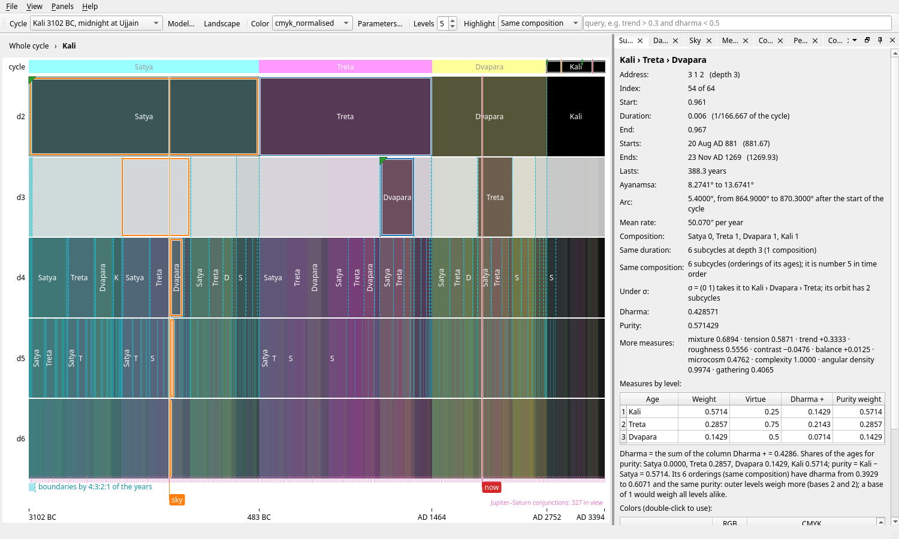

# cycles

Mathematical analysis of a cycle divided fractally into four ages.

A cycle is split into four ages in the ratio 4 : 3 : 2 : 1 (Satya, Treta,
Dvapara and Kali Yuga, or the Golden, Silver, Bronze and Iron ages), each age
again in the same ratio, and so on to any depth. The project studies the
resulting structure (durations, compositions, permutations, measures, colors,
sound), places the cycle in history through the precession of the equinoxes,
computes the sky at any moment with its own long-term N-body ephemeris, and
tests whether the subcycle boundaries fall on planetary events more often than
chance. A graphical explorer (PySide6) ties it all together.



## Installation

Requires Python 3.11 or later.

```bash
git clone https://github.com/jmcastelo/cycles.git
cd cycles
python -m venv .venv
source .venv/bin/activate
pip install -e ".[all]"        # or ".[all,test]" to run the tests
```

The core needs only NumPy, Matplotlib, `papersize` and `symmetry-math`. The
extras add `astro` (REBOUND, REBOUNDx: building the ephemeris), `sound`
(PyWavelets, sounddevice), `gui` (PySide6 and PySide6-QtAds, pinned together) and `test` (pytest, pytest-xdist); `all` is the
first three. For example, `pip install -e ".[astro]"` installs the core and the
ephemeris builder.

## Quick start

```bash
cycles-gui                                     # the explorer (or: python -m cycles.gui)
python sandbox/study_of_durations.py --list    # the studies of a script (* = default)
python sandbox/study_of_measures.py --save     # run its default studies, saving the figures
pytest -n 8                                    # all the tests, in 8 processes (under a minute)
```

The sky charts and the planetary events need the ephemeris tables, which are
not in the repository. Build them (a few hours, about 2.4 GB) with:

```bash
python -m cycles.functions.nbody_ephemeris build sandbox/data/tabla70k70k 70000 \
    --direction both --forward-years 70000 --workers 2
```

## Documentation

The full documentation is in Spanish, in [`docs/es`](docs/es/markdown/00_indice_y_glosario.md):
Markdown chapters with figures, which `docs/es/tex/md_a_tex.py` gathers into a
single LaTeX/PDF document (the PDF is attached to each release). The docs
describe the version of the program they match; see
[CHANGELOG.md](CHANGELOG.md) for what each version added.

| Chapter | Contents |
|---|---|
| [Index and glossary](docs/es/markdown/00_indice_y_glosario.md) | organisation, main results, conventions, glossary, references |
| **I. The structure** | |
| [1. Fractal division](docs/es/markdown/01_division_fractal.md) | the 4:3:2:1 rule, addresses and indices, durations, compositions |
| [2. Measures and colors](docs/es/markdown/02_medidas_y_colores.md) | dharma, purity and seven more measures; the colorings and their parameters |
| [3. Permutations](docs/es/markdown/03_permutaciones.md) | permutations of the digit positions, orbits, Burnside's lemma |
| **II. Astronomy and time** | |
| [4. Precession and ayanamsa](docs/es/markdown/04_precesion_y_ayanamsa.md) | sidereal and tropical zodiacs, linear and long-term precession |
| [5. Calendars and time scales](docs/es/markdown/05_calendarios_y_escalas_de_tiempo.md) | Julian day, decimal year, UT / TT / TDB, ΔT |
| [6. N-body ephemeris](docs/es/markdown/06_efemeride_nbody.md) | the integration, the tables, building them, accuracy |
| [7. Validation](docs/es/markdown/07_validacion.md) | comparisons with DE421, Moshier, PyEphem and Swiss Ephemeris |
| [8. The cycle model](docs/es/markdown/08_modelo_de_ciclo.md) | time maps, anchor, scale, division, presets, the two criteria, the landscape |
| [9. The Hindu division of time](docs/es/markdown/09_division_hindu_del_tiempo.md) | what is canonical, the relation with precession, the sources |
| **III. The software** | |
| [10. Architecture and modules](docs/es/markdown/10_arquitectura_y_modulos.md) | code layout, installation, module guide, versions |
| [11. Sandbox studies](docs/es/markdown/11_estudios_del_sandbox.md) | the study runner, its options, every study |
| [12. The graphical explorer](docs/es/markdown/12_aplicacion_grafica.md) | navigator, panels, sessions, dossier, layouts, shortcuts |
| [13. Tests](docs/es/markdown/13_pruebas.md) | running the tests and what they check |
| [14. Results and open questions](docs/es/markdown/14_resultados_y_preguntas_abiertas.md) | what has been found and what remains |
| **IV. Significance tests** | |
| [15. Planetary events and significance](docs/es/markdown/15_eventos_y_significacion.md) | event catalogues, rigid-rotation tests, the hypotheses tested |

All functions have docstrings, e.g. `help(compute_level)`.

## References

- Vondrák, J., Capitaine, N., Wallace, P. (2011). *New precession expressions,
  valid for long time intervals.* A&A 534, A22; corrigendum A&A 541, C1 (2012).
- Folkner, W. M., Williams, J. G., Boggs, D. H. (2009). *The Planetary and Lunar
  Ephemeris DE 421.* IPN Progress Report 42-178.
- Rein, H., Spiegel, D. S. (2015). *IAS15: a fast, adaptive, high-order
  integrator for gravitational dynamics.* MNRAS 446, 1424.
- Espenak, F., Meeus, J. *Polynomial expressions for Delta T.* NASA Eclipse Web
  Site.
- Simon, J. L. et al. (1994). *Numerical expressions for precession formulae
  and mean elements for the Moon and the planets.* A&A 282, 663; Meeus, J.
  (1998). *Astronomical Algorithms*, 2nd ed.
- ERFA (Essential Routines for Fundamental Astronomy), derived from SOFA (IAU).
- Abhyankar, K. D. (1993). Bull. Astr. Soc. India 21, 475–479.
- Burgess, E. (1860). *Translation of the Sûrya-Siddhânta.* Journal of the
  American Oriental Society 6.
- Billard, R. (1971). *L'astronomie indienne.* École française d'Extrême-Orient.
- Guénon, R. *Formes traditionnelles et cycles cosmiques*; Hani, J. (on the
  subdivision of the cycles).

## License

GNU General Public License v3.0 only. See [LICENSE](LICENSE).
