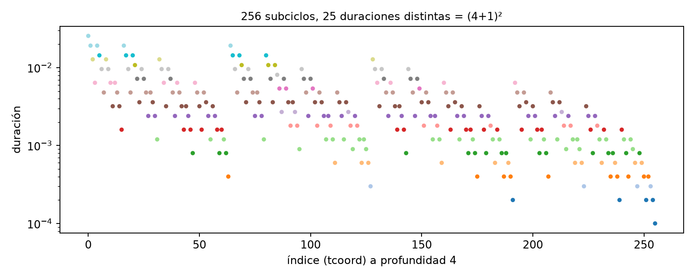
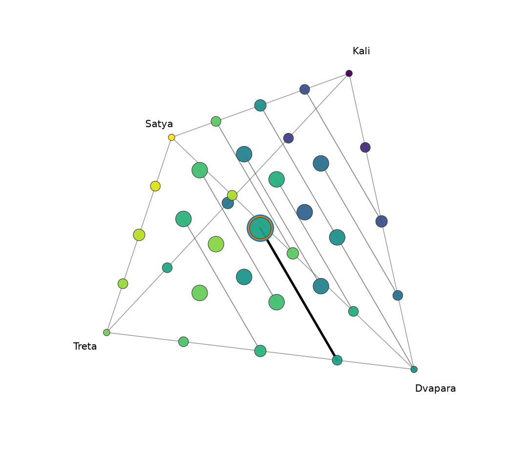

# 1. La división fractal 4:3:2:1

## 1.1 La regla

Un ciclo se divide en cuatro **edades** cuyas longitudes están en razón 4 : 3 : 2 : 1, es decir, 0,4, 0,3, 0,2
y 0,1 del total. En la tradición hindú son los cuatro yugas: **Satya** (o Krita), **Treta**, **Dvapara** y
**Kali**; en la griega, las edades de Oro, Plata, Bronce y Hierro. Cada edad se divide a su vez del mismo modo,
y así sucesivamente, hasta cualquier profundidad.

```
proporciones p = (0,4; 0,3; 0,2; 0,1)        edades 0, 1, 2, 3 = Satya, Treta, Dvapara, Kali
desplazamientos o = (0; 0,4; 0,7; 0,9)        dónde empieza cada edad dentro de su ciclo padre
```

Todo el trabajo se hace sobre el **intervalo unidad** [0, 1): el ciclo completo dura 1 y los inicios y
duraciones de los subciclos son fracciones de él. Llevarlo a años (u otras unidades) es tarea del *mapa de
tiempo* (capítulo 8).


## 1.2 Direcciones e índices

Un subciclo de profundidad *d* se identifica por su **dirección** (`lcoords` en el código): *d* dígitos
`a₁ a₂ … a_d`, cada uno la edad (0 a 3) elegida en un nivel, del ciclo exterior hacia dentro. Por ejemplo:

```
[3]          Kali
[3, 1]       Kali › Treta         (la parte Treta del Kali)
[3, 1, 2, 0] Kali › Treta › Dvapara › Satya
```

Leída como número en base 4, la dirección da el **índice** (`tcoord`): la posición del subciclo, en orden
temporal, entre los 4^d subciclos de su profundidad. Como los desplazamientos crecen con el dígito, ordenar por
índice es ordenar por inicio:

```
índice(a) = a₁·4^(d−1) + a₂·4^(d−2) + … + a_d          [3, 1, 2, 0] → 3·64 + 1·16 + 2·4 + 0 = 216
```

`cycles.functions.conversion` convierte entre las tres representaciones: dirección ↔ índice
(`lcoords_to_tcoord`, `tcoord_to_lcoords`) y dirección ↔ fracción en base *b* `0,a₁a₂a₃…`
(`lcoords_to_fractional`, `fractional_to_lcoords`).

## 1.3 Duración e inicio

La **duración** de un subciclo es el producto de las proporciones de las edades de su dirección; su **inicio**
se acumula nivel a nivel:

```
duración(a) = p[a₁] · p[a₂] · … · p[a_d]
inicio(a)   = o[a₁] + p[a₁]·o[a₂] + p[a₁]p[a₂]·o[a₃] + … + p[a₁]…p[a_(d−1)]·o[a_d]
```

Ejemplo: Kali › Treta › Dvapara › Satya dura 0,1 · 0,3 · 0,2 · 0,4 = 0,0024 del ciclo y empieza en 0,961.

Las funciones son `compute_duration` y `compute_start` (`cycles.functions.division`). La inversa, el subciclo
de profundidad *d* que contiene un instante *x* ∈ [0, 1), es `find_lcoords(x, d)`: en cada nivel se busca la
edad cuyo intervalo contiene *x* y se reescala *x* a esa edad.

## 1.4 Niveles

`compute_level(d)` devuelve un **`Level`**: todos los 4^d subciclos de profundidad *d* en orden temporal, con
sus direcciones, duraciones, inicios, todas las variantes de color (capítulo 2), dharma y pureza. Es una
`NamedTuple`; `level.subset(índices)` restringe a una parte, `select_subcycle(prefijo, level)` a los subciclos
dentro de un subciclo dado y `partition_level(level, subprofundidad, 4)` lo parte en grupos consecutivos.

| Profundidad | Subciclos | Duración mayor | Duración menor |
|---|---|---|---|
| 1 | 4 | 0,4 | 0,1 |
| 2 | 16 | 0,16 | 0,01 |
| 3 | 64 | 0,064 | 0,001 |
| 4 | 256 | 0,0256 | 0,0001 |
| 5 | 1 024 | 0,01024 | 0,00001 |
| *d* | 4^d | 0,4^d | 0,1^d |

El explorador gráfico calcula los niveles bajo demanda y los guarda en caché hasta la profundidad 8
(65 536 subciclos); el índice de un subciclo en su nivel es su `tcoord`.

## 1.5 Composiciones

La duración depende solo de **cuántas veces** aparece cada edad en la dirección, no de su orden. Esos
recuentos forman la **composición** de la dirección:

```
n = (n₀, n₁, n₂, n₃),   n₀ + n₁ + n₂ + n₃ = d
duración = 0,4^n₀ · 0,3^n₁ · 0,2^n₂ · 0,1^n₃
```

Kali › Treta › Dvapara › Satya tiene composición (1, 1, 1, 1): una de cada edad. Las direcciones con la misma
composición son las **ordenaciones** de sus dígitos: hay d! / (n₀! n₁! n₂! n₃!) de ellas (24 para (1, 1, 1, 1)).

El número de composiciones distintas de profundidad *d* es el de maneras de repartir *d* dígitos entre cuatro
edades:

```
número de composiciones = C(d + 3, 3)        4, 10, 20, 35, 56, 84, 120, 165 para d = 1 … 8
```

`cycles.functions.composition` las enumera (`compositions`), da todas las direcciones de una composición en
orden temporal (`lexmin_enumeration`, el algoritmo de la «permutación siguiente» para multiconjuntos) y las
agrupa por duración.

## 1.6 La regla (1, 0, −2, 1): clases de igual duración

Dos composiciones distintas pueden dar la misma duración. Como **0,4 · 0,1 = 0,2 · 0,2**, cambiar un Satya y un
Kali por dos Dvapara no altera el producto. Por eso todas las composiciones

```
n + t · (1, 0, −2, 1),   t entero, con todos los recuentos ≥ 0
```

tienen la misma duración, y no hay más coincidencias. Para verlo, se escribe la duración con números enteros:

```
duración = 4^n₀ · 3^n₁ · 2^n₂ · 1^n₃ / 10^d = 2^(2n₀ + n₂) · 3^n₁ / 10^d
```

A profundidad fija, la duración depende solo del par (n₁, 2n₀ + n₂), y dos composiciones tienen la misma
duración si y solo si coinciden en ese par: esa es la prueba de `duration.same_duration`
(`2·c₀ + c₂ = 0` y `c₁ = 0` para la diferencia de recuentos *c*). El cociente de dos duraciones de igual
profundidad es `2^(2c₀ + c₂) · 3^c₁` (`duration_quotient`).

**Número de clases de igual duración.** Fijado n₁ = *k*, quedan *m* = *d* − *k* dígitos para Satya, Dvapara y
Kali, y 2n₀ + n₂ toma todos los valores de 0 a 2*m*: son 2*m* + 1 duraciones. Sumando sobre *m* = 0 … *d*:

```
número de duraciones distintas a profundidad d = Σ (2m + 1) = (d + 1)²       4, 9, 16, 25, 36, 49, 64, 81
```

Se ha comprobado con el código hasta la profundidad 8. Las clases crecen: a profundidad 3 la mayor tiene 9
subciclos; a profundidad 4, 28 (duración 0,0024, la de Kali › Treta › Dvapara › Satya); a profundidad 5, 95.



Las clases se ven bien en el **tetraedro de composiciones** (capítulo 12): cada composición es un punto de un
tetraedro discreto cuyos vértices son las cuatro edades puras, y las clases de igual duración son los
segmentos paralelos a la dirección (1, 0, −2, 1).



## 1.7 Distancias entre subciclos de una clase

`cycles.functions.duration` mide también **dónde** caen en el tiempo los subciclos de un grupo (por ejemplo,
una clase de igual duración): `compute_all_distances` da las distancias entre los inicios de todos los pares,
y `compute_consecutive_distances` las de inicios consecutivos (con su cociente). Los estudios de
`study_of_durations.py` y `study_of_compositions.py` las dibujan (capítulo 11).

## 1.8 Particiones de un intervalo

`fill_partition(t1, t2, t, dt, dt_min)` cubre un intervalo [t1, t2) de un ciclo de longitud *t* con
subciclos: lo parte en ventanas de longitud `dt` y, dentro de cada una, toma uno tras otro el mayor subciclo
que cabe en lo que queda (`find_total_lcoords`), hasta que queda menos de `dt_min` (un hueco). Así se
representa un periodo cualquiera, por ejemplo un siglo, con la estructura de los yugas.
`study_of_fill_partitions.py` lo dibuja como diagramas de anillos.

## 1.9 Resumen

- Una dirección de *d* dígitos identifica cada subciclo; leída en base 4 es su posición en el tiempo.
- La duración es el producto de las proporciones; solo depende de la composición.
- Hay C(*d* + 3, 3) composiciones y (*d* + 1)² duraciones distintas; las composiciones de igual duración
  difieren en múltiplos de (1, 0, −2, 1) porque 0,4 · 0,1 = 0,2².
