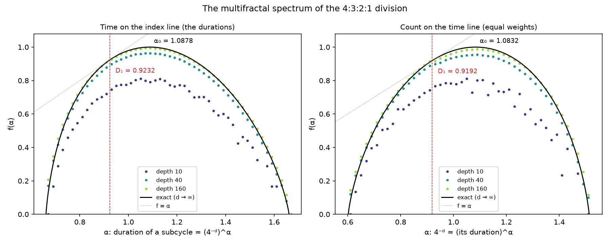

# 1. La división fractal 4:3:2:1

## 1.1 La regla

Un ciclo se divide en cuatro **edades** cuyas longitudes están en razón 4 : 3 : 2 : 1, es decir, 0,4, 0,3, 0,2
y 0,1 del total. En la tradición hindú son los cuatro yugas: **Satya** (o Krita), **Treta**, **Dvapara** y
**Kali**; en la griega, las edades de Oro, Plata, Bronce y Hierro. Cada edad se divide a su vez del mismo modo,
y así sucesivamente, hasta cualquier profundidad.

$$
p = (0{,}4;\ 0{,}3;\ 0{,}2;\ 0{,}1), \qquad o = (0;\ 0{,}4;\ 0{,}7;\ 0{,}9)
$$

con las edades $0, 1, 2, 3$ = Satya, Treta, Dvapara, Kali: $p$ son las proporciones y $o$ los desplazamientos,
dónde empieza cada edad dentro de su ciclo padre.

Todo el trabajo se hace sobre el **intervalo unidad** [0, 1): el ciclo completo dura 1 y los inicios y
duraciones de los subciclos son fracciones de él. Llevarlo a años (u otras unidades) es tarea del *mapa de
tiempo* (capítulo 8).


## 1.2 Direcciones e índices

Un subciclo de profundidad $d$ se identifica por su **dirección** (`lcoords` en el código): $d$ dígitos
$a_1 a_2 \dots a_d$, cada uno la edad (0 a 3) elegida en un nivel, del ciclo exterior hacia dentro. Por ejemplo:

```
[3]          Kali
[3, 1]       Kali › Treta         (la parte Treta del Kali)
[3, 1, 2, 0] Kali › Treta › Dvapara › Satya
```

Leída como número en base 4, la dirección da el **índice** (`tcoord`): la posición del subciclo, en orden
temporal, entre los $4^d$ subciclos de su profundidad. Como los desplazamientos crecen con el dígito, ordenar por
índice es ordenar por inicio:

$$
\operatorname{índice}(a) = a_1 4^{d-1} + a_2 4^{d-2} + \dots + a_d,
\qquad [3, 1, 2, 0] \mapsto 3 \cdot 64 + 1 \cdot 16 + 2 \cdot 4 + 0 = 216
$$

`cycles.functions.conversion` convierte entre las tres representaciones: dirección ↔ índice
(`lcoords_to_tcoord`, `tcoord_to_lcoords`) y dirección ↔ fracción en base $b$
(`lcoords_to_fractional`, `fractional_to_lcoords`): la fracción $0{,}a_1 a_2 a_3\dots$ en base $b$.

## 1.3 Duración e inicio

La **duración** de un subciclo es el producto de las proporciones de las edades de su dirección; su **inicio**
se acumula nivel a nivel:

$$
\operatorname{duración}(a) = \prod_{k=1}^{d} p_{a_k}, \qquad
\operatorname{inicio}(a) = \sum_{k=1}^{d} o_{a_k} \prod_{j<k} p_{a_j}
= o_{a_1} + p_{a_1} o_{a_2} + p_{a_1} p_{a_2} o_{a_3} + \dots
$$

Ejemplo: Kali › Treta › Dvapara › Satya dura $0{,}1 \cdot 0{,}3 \cdot 0{,}2 \cdot 0{,}4 = 0{,}0024$ del ciclo y empieza en
$0{,}961$.

Las funciones son `compute_duration` y `compute_start` (`cycles.functions.division`). La inversa, el subciclo
de profundidad $d$ que contiene un instante $x \in [0, 1)$, es `find_lcoords(x, d)`: en cada nivel se busca la
edad cuyo intervalo contiene $x$ y se reescala $x$ a esa edad.

## 1.4 Niveles

`compute_level(d)` devuelve un **`Level`**: todos los $4^d$ subciclos de profundidad $d$ en orden temporal, con
sus direcciones, duraciones, inicios, todas las variantes de color (capítulo 2), dharma y pureza. Es una
`NamedTuple`; `level.subset(índices)` restringe a una parte, `select_subcycle(prefijo, level)` a los subciclos
dentro de un subciclo dado y `partition_level(level, subprofundidad, 4)` lo parte en grupos consecutivos.

| Profundidad | Subciclos | Duración mayor | Duración menor |
|---|---|---|---|
| 1 | 4 | 0,4 | 0,1 |
| 2 | 16 | 0,16 | 0,01 |
| 3 | 64 | 0,064 | 0,001 |
| 4 | 256 | 0,0256 | 0,0001 |
| 5 | 1 024 | 0,01024 | 0,00001 |
| $d$ | $4^d$ | $0{,}4^d$ | $0{,}1^d$ |

El explorador gráfico calcula los niveles bajo demanda y los guarda en caché hasta la profundidad 9 (262 144
subciclos); el índice de un subciclo en su nivel es su `tcoord`. `compute_level` calcula el nivel entero de una
vez, con operaciones vectorizadas de numpy: la profundidad 8 tarda unas centésimas de segundo, la 9 un cuarto de
segundo y la 10 algo más de uno (pero ocupa más de 500 MB, y por eso el explorador se queda en la 9).

## 1.5 Composiciones

La duración depende solo de **cuántas veces** aparece cada edad en la dirección, no de su orden. Esos
recuentos forman la **composición** de la dirección:

$$
n = (n_0, n_1, n_2, n_3), \quad n_0 + n_1 + n_2 + n_3 = d, \qquad
\operatorname{duración} = 0{,}4^{n_0}\, 0{,}3^{n_1}\, 0{,}2^{n_2}\, 0{,}1^{n_3}
$$

Kali › Treta › Dvapara › Satya tiene composición $(1, 1, 1, 1)$: una de cada edad. Las direcciones con la misma
composición son las **ordenaciones** de sus dígitos: hay $\dfrac{d!}{n_0!\, n_1!\, n_2!\, n_3!}$ de ellas (24 para
$(1, 1, 1, 1)$).

El número de composiciones distintas de profundidad *d* es el de maneras de repartir *d* dígitos entre cuatro
edades:

$$
\text{número de composiciones} = \binom{d+3}{3}: \qquad 4,\ 10,\ 20,\ 35,\ 56,\ 84,\ 120,\ 165 \quad (d = 1, \dots, 8)
$$

`cycles.functions.composition` las enumera (`compositions`), da todas las direcciones de una composición en
orden temporal (`lexmin_enumeration`, el algoritmo de la «permutación siguiente» para multiconjuntos) y las
agrupa por duración.

## 1.6 La regla (1, 0, −2, 1): clases de igual duración

Dos composiciones distintas pueden dar la misma duración. Como $0{,}4 \cdot 0{,}1 = 0{,}2 \cdot 0{,}2$, cambiar un Satya y
un Kali por dos Dvapara no altera el producto. Por eso todas las composiciones

$$
n + t\,(1, 0, -2, 1), \qquad t \in \mathbb{Z}, \text{ con todos los recuentos} \ge 0
$$

tienen la misma duración, y no hay más coincidencias. Para verlo, se escribe la duración con números enteros:

$$
\operatorname{duración} = \frac{4^{n_0}\, 3^{n_1}\, 2^{n_2}\, 1^{n_3}}{10^d} = \frac{2^{2n_0 + n_2}\, 3^{n_1}}{10^d}
$$

A profundidad fija, la duración depende solo del par $(n_1,\, 2n_0 + n_2)$, y dos composiciones tienen la misma
duración si y solo si coinciden en ese par: esa es la prueba de `duration.same_duration`
($2c_0 + c_2 = 0$ y $c_1 = 0$ para la diferencia de recuentos $c$). El cociente de dos duraciones de igual
profundidad es $2^{2c_0 + c_2}\, 3^{c_1}$ (`duration_quotient`).

**Número de clases de igual duración.** Fijado $n_1 = k$, quedan $m = d - k$ dígitos para Satya, Dvapara y
Kali, y $2n_0 + n_2$ toma todos los valores de $0$ a $2m$: son $2m + 1$ duraciones. Sumando sobre $m = 0, \dots, d$:

$$
\text{número de duraciones distintas} = \sum_{m=0}^{d} (2m + 1) = (d + 1)^2: \qquad 4,\ 9,\ 16,\ 25,\ 36,\ 49,\ 64,\ 81
$$

Se ha comprobado con el código hasta la profundidad 8. Las clases crecen: a profundidad 3 la mayor tiene 9
subciclos; a profundidad 4, 28 (duración 0,0024, la de Kali › Treta › Dvapara › Satya); a profundidad 5, 95.


Las clases se ven bien en el **tetraedro de composiciones** (capítulo 12): cada composición es un punto de un
tetraedro discreto cuyos vértices son las cuatro edades puras, y las clases de igual duración son los
segmentos paralelos a la dirección (1, 0, −2, 1).


## 1.7 Distancias entre subciclos de una clase

`cycles.functions.duration` mide también **dónde** caen en el tiempo los subciclos de un grupo (por ejemplo,
una clase de igual duración): `compute_all_distances` da las distancias entre los inicios de todos los pares,
y `compute_consecutive_distances` las de inicios consecutivos (con su cociente). Los estudios de
`study_of_durations.py` y `study_of_compositions.py` las dibujan (capítulo 11).

## 1.8 Particiones de un intervalo

`fill_partition(t1, t2, t, dt, dt_min)` cubre un intervalo $[t_1, t_2)$ de un ciclo de longitud $t$ con
subciclos: lo parte en ventanas de longitud `dt` y, dentro de cada una, toma uno tras otro el mayor subciclo
que cabe en lo que queda (`find_total_lcoords`), hasta que queda menos de `dt_min` (un hueco). Así se
representa un periodo cualquiera, por ejemplo un siglo, con la estructura de los yugas.
`study_of_fill_partitions.py` lo dibuja como diagramas de anillos.

## 1.9 El espectro multifractal

La división pone en el ciclo dos medidas, y cada una es muy desigual vista desde la otra:

- **el tiempo**: cada subciclo recibe su duración. Vista sobre la línea de los **índices** (todos los subciclos
  de una profundidad igual de anchos, $4^{-d}$), es la cascada multinomial de pesos $(0{,}4;\ 0{,}3;\ 0{,}2;\
  0{,}1)$;
- **el recuento**: todos los subciclos de una profundidad pesan lo mismo, $4^{-d}$. Vista sobre la línea del
  **tiempo** (cada subciclo tan largo como su duración), es la medida autosemejante de pesos $\tfrac14$ y
  razones $0{,}4 \dots 0{,}1$.

Un subciclo encoge en tamaño como $r_{a_1} \cdots r_{a_d}$ y en peso como $w_{a_1} \cdots w_{a_d}$; su
**exponente de Hölder** es $\alpha = \log(\text{peso}) / \log(\text{tamaño})$. El **espectro** $f(\alpha)$ es la
dimensión del conjunto de puntos con exponente $\alpha$. Se calcula exactamente con la función de momentos
$\tau(q)$, la solución de

$$
\sum_{i} w_i^{\,q}\, r_i^{-\tau(q)} = 1, \qquad \alpha(q) = \tau'(q), \qquad f(\alpha(q)) = q\,\alpha(q) - \tau(q)
$$

(una transformada de Legendre; `cycles.functions.multifractal`).



| | El tiempo, sobre los índices | El recuento, sobre el tiempo |
|---|---|---|
| $\alpha$ de una dirección toda Satya / toda Kali | 0,6610 / 1,6610 | 1,5129 / 0,6021 |
| $\alpha_0$ (donde $f = 1$: lo más numeroso) | 1,0878 | 1,0832 |
| dimensión de información $D_1$ | **0,9232** | **0,9192** |
| dimensión de correlación $D_2$ | 0,8685 | 0,8511 |

Qué dicen:

- **El tiempo se concentra en pocos subciclos.** $D_1 = H / \log 4 = 0{,}9232$, con $H$ la entropía de
  $(0{,}4;\ 0{,}3;\ 0{,}2;\ 0{,}1)$: casi todo el tiempo lo ocupa un conjunto de subciclos de dimensión 0,92 entre
  los índices, unos $4^{0{,}92\,d}$ de los $4^d$. Y el subciclo más común por número ($\alpha_0 = 1{,}088$) dura
  menos que la media, $4^{-1{,}088\,d}$ en vez de $4^{-d}$: la media geométrica de las proporciones, 0,221, es
  menor que $\tfrac14$.
- **Los subciclos se concentran en poco tiempo.** $D_1 = \log 4 / \overline{(-\log p)} = 0{,}9192$: casi todos
  los subciclos, contados, caen en un conjunto de instantes de dimensión 0,92, las regiones donde abundan los
  dígitos Kali.
- **Las dos medidas son duales.** Intercambiar pesos y tamaños cambia $\alpha$ por $1/\alpha$ y $f$ por
  $f/\alpha$, así que la dimensión de información de cada una es la inversa del exponente típico de la otra:
  $0{,}9232 = 1/1{,}0832$ y $0{,}9192 = 1/1{,}0878$.

A una profundidad finita, $\alpha$ solo depende del producto de las proporciones de la dirección, la duración: los
subciclos con un mismo $\alpha$ son exactamente **una clase de igual duración** (1.6). Pero $f(\alpha)$ cuenta todos
los puntos con exponente *cerca* de $\alpha$: una clase puede ser pequeña mientras sus vecinas reúnen casi todos
los subciclos (la de la dirección toda Treta tiene un solo miembro, y sin embargo $f \approx 0{,}86$ en ese
$\alpha$). Por eso la estimación finita (`histogram_spectrum`) agrupa las clases en intervalos de $\alpha$ y suma
sus subciclos; a profundidad 160 se aparta de la curva exacta menos de 0,02 en el interior, y más despacio en los
extremos. `study_of_multifractal.py` imprime los valores y dibuja la figura.

## 1.10 Resumen

- Una dirección de $d$ dígitos identifica cada subciclo; leída en base 4 es su posición en el tiempo.
- La duración es el producto de las proporciones; solo depende de la composición.
- Hay $\binom{d+3}{3}$ composiciones y $(d + 1)^2$ duraciones distintas; las composiciones de igual duración
  difieren en múltiplos de $(1, 0, -2, 1)$ porque $0{,}4 \cdot 0{,}1 = 0{,}2^2$.
- El espectro multifractal mide lo desigual del reparto: casi todo el tiempo está en un conjunto de subciclos de
  dimensión 0,92, y casi todos los subciclos en un conjunto de instantes de dimensión 0,92; las dos medidas son
  duales.
