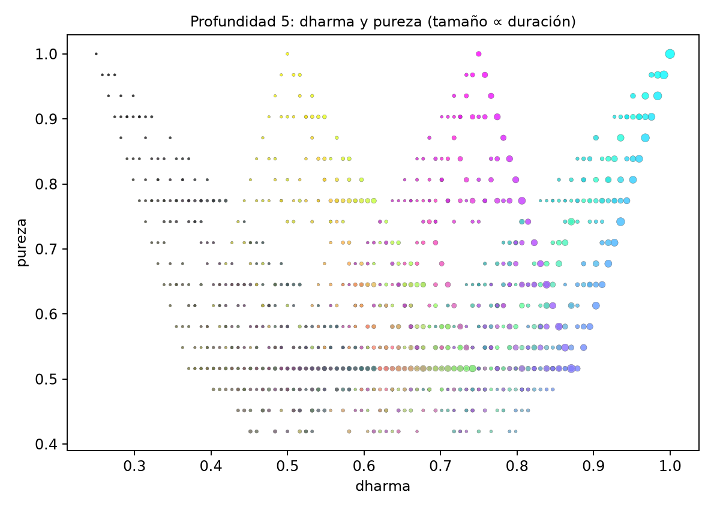
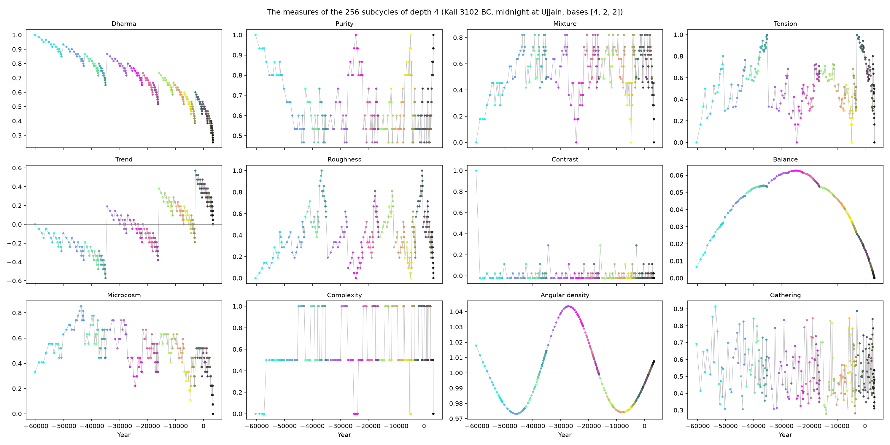
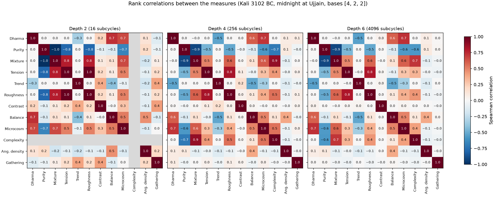
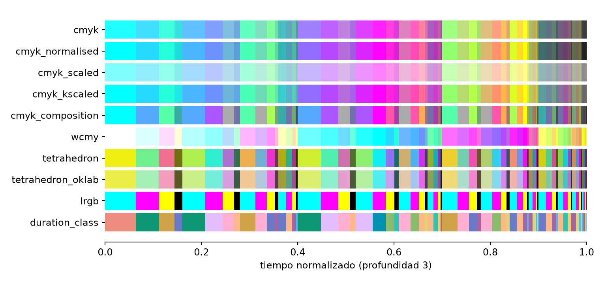
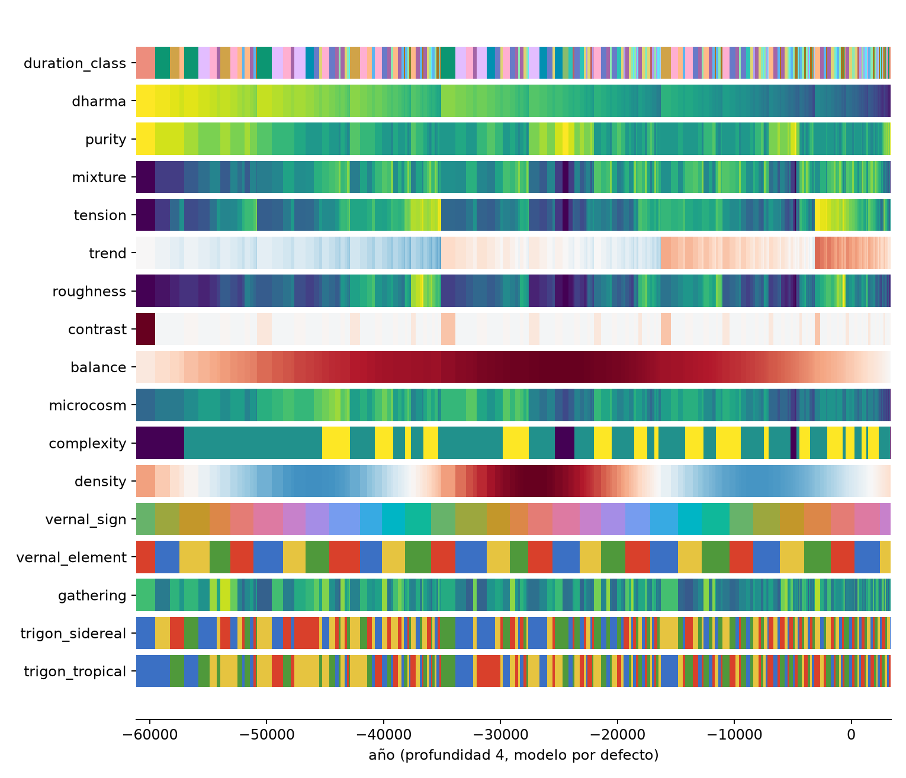

# 2. Medidas y colores

Cada subciclo recibe, a partir de su dirección, dos **medidas** escalares principales (dharma y pureza), otras
seis derivadas de ellas o de la misma dirección (2.4), una que depende del modelo de ciclo, y varios **colores**.
Medidas y colores usan **pesos por posición**: el dígito del nivel $k$ pesa $b^{-k}$, de modo que los niveles exteriores
cuentan más que los interiores (`division.weights`):

$$
w(b, d) = \left(b^{-1},\ b^{-2},\ \dots,\ b^{-d}\right)
$$

Las bases son parámetros (`compute_level(d, bases, scales, colors)`):

| Parámetro | Valor por defecto | Uso |
|---|---|---|
| `bases[0]` | 4 | base de la división (número de edades); no se cambia |
| `bases[1]` | 2 | base de los pesos de los colores CMYK y del dharma |
| `bases[2]` | 2 | base de los pesos de la pureza |
| `scales[0]` | 1/2 | escala de `cmyk_scaled` |
| `scales[1]` | 2/3 | escala del negro de `cmyk_kscaled` |
| `scales[2]` | 1/2 | paso del coloreado del tetraedro |
| `colors` | amarillo, cian, magenta, negro | vértices del tetraedro de color (Satya, Treta, Dvapara, Kali) |

## 2.1 Dharma

Cada edad tiene una **virtud**: Satya 1, Treta 3/4, Dvapara 1/2, Kali 1/4 (es decir, $(4 - a)/4$). El **dharma**
de un subciclo es la media de las virtudes de sus dígitos, ponderada con los pesos de base `bases[1]`
(`measure.dharma_measure`):

$$
\operatorname{dharma}(a) = \frac{\sum_k w_k\, (4 - a_k)/4}{\sum_k w_k}
$$

Vale 1 para una dirección toda Satya y 1/4 para una toda Kali. Ejemplo, Kali › Treta › Dvapara › Satya con base
2: pesos normalizados (0,5333; 0,2667; 0,1333; 0,0667), virtudes (1/4; 3/4; 1/2; 1), aportaciones (0,1333;
0,2; 0,0667; 0,0667), dharma = **0,4667**.

Con la variante de color `cmyk_normalised` el dharma se puede leer del propio color
(`dharma_from_cmyk`): es el producto escalar de las tintas con (1, 3/4, 1/2, 1/4).

## 2.2 Pureza

La **pureza** mide cuánto domina una sola edad. Se calcula la **cuota** ponderada de cada edad (la suma de los
pesos, de base `bases[2]`, de sus dígitos, dividida por la suma de todos los pesos) y se toma la mayor menos la
menor:

$$
\operatorname{cuota}_e(a) = \frac{\sum_{k:\, a_k = e} w_k}{\sum_k w_k}, \qquad
\operatorname{pureza}(a) = \max_e \operatorname{cuota}_e - \min_e \operatorname{cuota}_e
$$

(`measure.purity_measure`).

Vale 1 si todos los dígitos son de la misma edad y 0 si las cuatro edades pesan lo mismo. En el ejemplo, las
cuotas son Satya 0,0667, Treta 0,2667, Dvapara 0,1333 y Kali 0,5333: pureza = Kali − Satya = **0,4667**.

## 2.3 Las medidas por nivel

El panel *Subcycle* del explorador desglosa ambas medidas nivel a nivel (`state.measure_breakdown`): el peso
de cada nivel, la virtud de su edad, lo que suma al dharma y su peso en la pureza. Muestra además el **rango**
de las dos medidas sobre las ordenaciones de la misma composición: el orden de los dígitos no cambia la
duración, pero sí las medidas, porque los niveles exteriores pesan más.

Para Kali › Treta › Dvapara › Satya, sus 24 ordenaciones tienen dharma entre 0,4333 y 0,8167, y todas la misma
pureza (con un dígito de cada edad, la pureza es siempre el mayor peso menos el menor). Con base 1 (todos los
niveles igual) ambas medidas serían iguales en toda la clase.

Rangos: el dharma va de 1/4 a 1 en todas las profundidades; la pureza mínima baja con la profundidad (4/7 ≈
0,571 a profundidad 3, 13/31 ≈ 0,419 a profundidad 5, con base 2). A profundidad 4 hay 46 valores distintos de
dharma y solo 9 de pureza.

## 2.4 Más medidas

Dharma y pureza resumen la dirección en dos números: la virtud media y el dominio de una edad. La dirección dice
más: cuánto se separan las edades mezcladas, en qué orden aparecen, dónde está el subciclo en el tiempo. Con las
virtudes $v_k = (4 - a_k)/4$, los pesos normalizados $\hat w_k = w_k / \sum_j w_j$ (de `bases[1]` para las
virtudes y de `bases[2]` para las cuotas, como el dharma y la pureza) y las cuotas $p_e$ de 2.2,
`cycles.functions.measure` calcula, para un nivel entero y de forma vectorizada:

| Medida | Definición | Qué dice |
|---|---|---|
| **Mezcla** (`mixture_measure`) | $-\sum_e p_e \log p_e \,/\, \log 4$ | entropía de las cuotas: ve todas, no solo la mayor y la menor (0 a 1) |
| **Tensión** (`tension_measure`) | $\sqrt{\sum_k \hat w_k (v_k - \operatorname{dharma})^2}\,/\,\tfrac38$ | lo lejos que están las edades mezcladas: Satya con Kali tensa más que Satya con Treta (0 a 1) |
| **Tendencia** (`trend_measure`) | $\sum_{k<d} \hat w'_k (v_{k+1} - v_k)\,/\,\tfrac34$ | positiva si los niveles interiores son mejores que los exteriores (−1 a 1) |
| **Aspereza** (`roughness_measure`) | $\sum_{k<d} \hat w'_k\, \lvert v_{k+1} - v_k\rvert\,/\,\tfrac34$ | lo bruscos que son los saltos de edad entre niveles consecutivos (0 a 1) |
| **Contraste** (`contrast_measure`) | $(\operatorname{dharma}_i - \operatorname{dharma}_{i-1})\,/\,\tfrac34$ | el salto de dharma al empezar el subciclo, la *sandhi* o juntura (−1 a 1) |
| **Balance** (`balance_measure`) | $\sum_{j \le i} (\operatorname{dharma}_j - \overline{\operatorname{dharma}})\, \delta_j$ | el saldo acumulado desde el inicio del ciclo |
| **Microcosmos** (`microcosm_measure`) | $1 - \tfrac12 \sum_e \lvert p_e - q_e\rvert \,/\, 0{,}9$ | cuánto se parecen las cuotas de la dirección a las del ciclo entero, $q = (0{,}4;\ 0{,}3;\ 0{,}2;\ 0{,}1)$: la parte que refleja el todo (0 a 1) |
| **Complejidad** (`complexity_measure`) | complejidad de Lempel–Ziv de la dirección, escalada entre la mínima y la máxima del nivel | 0 para una edad repetida, 1 para la dirección más irregular (0 a 1) |

En la tendencia y la aspereza, el paso entre los niveles $k$ y $k+1$ pesa como el exterior de los dos
($\hat w'$, los pesos $w_1 \dots w_{d-1}$ normalizados); a profundidad 1 ambas valen 0. Las divisiones por
$\tfrac34$ (la mayor diferencia de virtudes) y por $\tfrac38$ (la mayor desviación, mitad Satya y mitad Kali)
llevan cada medida a un rango fijo, comparable entre profundidades.

- La **tendencia** recoge una idea de la tradición jainista: el ciclo del tiempo tiene una mitad descendente
  (*avasarpiṇī*) y otra ascendente (*utsarpiṇī*). Aquí un subciclo puede ser un ascenso dentro de un descenso:
  Kali › Satya tiene tendencia +1.
- El **microcosmos** recoge la idea de que cada parte del ciclo refleja el todo. Mide la distancia de variación
  total entre las cuotas de la dirección y las del ciclo; 0,9 es la mayor posible (una dirección toda Kali).
- La **complejidad** cuenta, con el algoritmo de Kaspar y Schuster (1987), las frases nuevas que aparecen al leer
  la dirección (Lempel y Ziv, 1976): pocas si se repite (Kali › Kali › Kali), muchas si es irregular. Solo ve el
  orden de las edades, no los pesos. Con direcciones cortas toma pocos valores: cinco a profundidad 8, y a
  profundidad 2 es constante.
- El **contraste** y el **balance** dependen del lugar en el tiempo, no solo de la dirección: se calculan sobre
  el nivel entero en orden temporal. En el contraste, el ciclo se repite, así que el primer subciclo sigue al
  último. En el balance, $\delta_j$ es la duración y $\overline{\operatorname{dharma}} = \sum_j
  \operatorname{dharma}_j\, \delta_j$ la media ponderada por duración, de modo que el saldo vuelve a 0 al final
  del ciclo; sus extremos marcan puntos de giro.

Dos medidas más no salen de la dirección. La **densidad angular** depende del **modelo de ciclo** (capítulo 8):

$$
\operatorname{densidad}(a) = \frac{\Delta\lambda_a / \Delta\lambda}{\Delta t_a / \Delta t}
$$

la cuota del arco de precesión que barre el subciclo entre su cuota del tiempo, es decir, su ritmo medio de
precesión entre el del ciclo entero (`cycle_analysis.angular_density`). Por encima de 1, el equinoccio avanza
más deprisa que la media. Con precesión constante vale 1 en todas partes.

La **reunión** (*gathering*) depende además de la **efeméride** (capítulo 6): cuán juntos están los planetas del
Sol a Saturno al empezar el subciclo, $1 - \text{arco}/360°$, con *arco* el menor arco que los contiene a todos
(el mismo de la hipótesis H1, capítulo 15; `events.around_point`). Vale 1 si están todos en un punto. Los inicios
de los subciclos se pasan de UT a TDB (la escala de la efeméride) interpolando el ΔT sobre una rejilla.

Todas están en el registro `measure.MEASURES` (nombre, rango, parámetro del que dependen, descripción). El panel
*Measures* del explorador pone cualquiera de ellas en cada eje o colorea los puntos con ella, y el inspector
las muestra todas en una línea (capítulo 12).

Lo que se ve en el tiempo:

- El dharma **baja despacio y sube de golpe**. El contraste es casi siempre un poco negativo (−0,048 como mucho a
  profundidad 3) y tiene picos positivos al empezar cada nueva Satya.
- El **balance** es positivo en todo el ciclo y tiene su máximo hacia la mitad, donde el dharma cruza su media.
- La **densidad angular** oscila ±4 % con un periodo de unos 40 000 años: es la variación del ritmo de precesión
  del modelo de largo plazo, ligada a la oblicuidad (capítulo 4), no la estructura de los yugas.
- La **reunión** salta de un subciclo a otro sin tendencia: el cielo no sigue la división. Al inicio del Kali vale
  0,89 (los planetas, juntos cerca de 0° de Aries: H1), pero eso es el ancla del modelo.

¿Cuáles aportan información propia? Las correlaciones de rango (Spearman) entre las medidas responden
(`study_of_measures.py measure_correlations`):

| Par | Correlación (profundidad 6) | Lectura |
|---|---|---|
| pureza – mezcla | −0,91 | la mezcla repite casi la pureza |
| tensión – aspereza | 0,81 | la aspereza repite casi la tensión (1,00 a profundidad 2) |
| dharma – balance | 0,60 | el balance es en parte dharma acumulado |
| dharma – tendencia | −0,54 | una tendencia alta exige un nivel exterior bajo |
| dharma – pureza | 0,00 | independientes por simetría |
| dharma – microcosmos | 0,73 | el microcosmos es en buena parte dharma: el todo pesa hacia el Satya |
| mezcla – complejidad | 0,71 | la complejidad repite en parte la mezcla (0,88 a profundidad 4) |
| contraste – cualquiera | ≤ 0,05 | información propia |
| densidad – cualquiera | ≤ 0,38 | información propia (física) |
| reunión – cualquiera | ≤ 0,05 | información propia (del cielo) |

Las medidas nuevas que dicen algo que no decían el dharma y la pureza son la **tendencia**, el **contraste**, la
**densidad angular** y la **reunión**; la tensión, la mezcla y la complejidad matizan la pureza, y el microcosmos,
el dharma.

## 2.5 Colores: las edades como tintas

Cada edad se asocia a una tinta de imprenta: **Satya → cian, Treta → magenta, Dvapara → amarillo, Kali →
negro**. Cada dígito añade su peso a la tinta de su edad, y de esas sumas salen las variantes CMYK
(`color.lcoords_to_cmyk`), convertidas a RGB con $\mathrm{RGB} = (1 - \mathrm{CMY})\,(1 - \mathrm{K})$:

| Variante | Definición |
|---|---|
| `cmyk` | sumas ponderadas de las tintas |
| `cmyk_normalised` | divididas por la suma de los pesos (la variante por defecto) |
| `cmyk_scaled` | normalizadas y multiplicadas por `scales[0]` (más claras) |
| `cmyk_kscaled` | normalizadas, con solo el negro multiplicado por `scales[1]` |
| `cmyk_composition` | recuentos de dígitos sin pesos, divididos por la profundidad: depende solo de la composición |
| `wcmy` | normalizadas y desplazadas una tinta: Satya → blanco, Treta → cian, Dvapara → magenta, Kali → amarillo, sin negro |

Además hay cuatro coloreados más que solo dependen de la dirección (`division.level_colors`):

| Coloreado | Definición |
|---|---|
| `tetrahedron` | «juego del caos» en el espacio RGB (2.6) |
| `tetrahedron_oklab` | el mismo juego en OKLab, un espacio perceptual (2.6) |
| `lrgb` | la tinta pura de la edad del último nivel |
| `duration_class` | un color por clase de igual duración (2.7) |

Estos diez son `division.LEVEL_COLOR_KEYS`. Con los diez de las medidas, los tres del modelo de ciclo y los tres
del cielo (2.7), `COLOR_KEYS` tiene **veintiséis** coloreados, con una descripción de cada uno en `division.COLOR_DESCRIPTIONS`.
Ejemplo, Kali › Treta › Dvapara › Satya: `cmyk` = (0,0625; 0,25; 0,125; 0,5); `cmyk_normalised` = (0,0667;
0,2667; 0,1333; 0,5333); `cmyk_composition` = (¼, ¼, ¼, ¼).

## 2.6 El tetraedro de Sierpinski

El coloreado `tetrahedron` coloca las cuatro edades en cuatro colores-vértice (por defecto amarillo, cian,
magenta y negro, el mayor tetraedro que cabe en el cubo RGB, de volumen 1/3) y parte del centroide; cada
dígito acerca el punto una fracción `scales[2]` hacia el vértice de su edad:

$$
c_0 = \bar v = \tfrac14 \sum_e v_e, \qquad c_k = c_{k-1} + s\,\left(v_{a_k} - c_{k-1}\right)
$$

(`color.lcoords_to_rgb_tetrahedron`, con $v_e$ los colores-vértice). Con $s = 1/2$, los colores de todas las
direcciones llenan un **tetraedro de Sierpinski**. El último dígito es el que más pesa: decide en cuál de los
cuatro tetraedros de mitad de tamaño cae el color.

### La variante perceptual: `tetrahedron_oklab`

En RGB, pasos iguales no se ven iguales: cerca del negro las diferencias se aprecian menos que cerca del
amarillo. **OKLab** (Ottosson, 2020) es un espacio de color construido para que las distancias correspondan a lo
que se percibe (`color.srgb_to_oklab`, `color.oklab_to_srgb`). `tetrahedron_oklab` juega el mismo juego del caos
con los vértices llevados a OKLab, de modo que la diferencia que se ve entre dos colores refleja por igual, en
todas las esquinas, la diferencia entre sus direcciones.

La gama de sRGB no es convexa en OKLab: la recta de un color de la gama a otro puede salirse de ella (la de
amarillo a magenta lo hace). Por eso los vértices se encogen hacia su centroide por el mayor factor que mantiene
dentro de la gama los colores de todos los subciclos hasta la profundidad 8 (`color.oklab_tetrahedron`, por
bisección; 0,966 con los vértices por defecto). Encoger conserva la geometría exacta, cosa que recortar no haría.

| | `tetrahedron` | `tetrahedron_oklab` |
|---|---|---|
| tamaño percibido de las regiones de las cuatro edades a profundidad 6 (mayor / menor) | 1,26 | **1,00** |
| colores distintos en pantalla a profundidad 8 (de 65 536) | **65 536** | 56 689 |

Es un intercambio, no una mejora: la variante perceptual hace iguales a la vista las regiones de las cuatro
edades, pero la pantalla separa menos colores, porque sRGB codifica los tonos oscuros con pocos niveles y el
reparto uniforme pone muchos colores en ellos (a profundidad 8, 64 subciclos de la esquina del Kali quedan en
negro puro). Para distinguir subciclos profundos conviene `tetrahedron`; para comparar a simple vista regiones
del ciclo, `tetrahedron_oklab`.

## 2.7 Coloreados por clase, por medida y por el punto vernal

Otros diecisiete coloreados miran más allá de la dirección: el nivel entero, las medidas, el modelo de ciclo o
el cielo.

- **`duration_class`**: un color por clase de igual duración (capítulo 1). Las clases, de la más larga a la más
  corta, toman tonos separados por el ángulo áureo (137,5°, cada uno lejos de los anteriores) y tres
  luminosidades alternas, en OKLab para que todos se vean igual de intensos (`color.duration_class_colors`). Los
  subciclos del mismo color son intercambiables en duración; a profundidad *d* hay $(d + 1)^2$ colores.
- **Las medidas** (`MEASURE_COLOR_KEYS`): `dharma`, `purity` y las de 2.4, `mixture`, `tension`, `trend`,
  `roughness`, `contrast`, `balance`, `microcosm` y `complexity`, todas por igual: un mapa de color **secuencial** para las que van de 0 a 1
  (de 1/4 a 1 el dharma) y uno **divergente** para las que tienen signo (`color.DIVERGING_MEASURES`, con el 0 en
  el centro), sobre el rango fijo de cada medida (`color.measure_colors`, la misma función del panel
  *Measures*). El color de un subciclo no depende del zoom: el balance, sin rango fijo, se escala con el nivel
  entero.

Los tres últimos dependen del **modelo de ciclo** (`MODEL_COLOR_KEYS`) y se ven en gris claro sin él:

- `density`: la densidad angular de 2.4, en el mapa divergente con el 1 (el ritmo medio) en el centro: con el
  mapa por defecto, azul donde la precesión va más despacio que la media y rojo donde va más deprisa;
- `vernal_sign`: el signo sidéreo en el que está el **punto vernal** al empezar el subciclo (doce tonos, Aries
  rojo). El punto vernal está en 0° trópico, así que su longitud sidérea es $-\text{ayanāṃśa}$
  (`color.vernal_point_longitude`); hoy, unos 336°: Piscis;
- `vernal_element`: el elemento de ese signo: fuego rojo, tierra verde, aire amarillo, agua azul.

Otros tres dependen del modelo y de la **efeméride** (`SKY_COLOR_KEYS`): el estado los recibe del panel *Sky*, y
se ven en gris sin ella:

- `gathering`: la reunión de 2.4, en el mapa secuencial;
- `trigon_sidereal` y `trigon_tropical`: el **trígono** (elemento) de las grandes conjunciones de Júpiter y
  Saturno **vigente** al empezar el subciclo, en el zodiaco sidéreo o en el trópico, con los colores de los
  elementos. Es el del último periodo empezado antes (`events.trigon_periods` y `events.trigon_in_force`, con la
  regla de asentamiento del capítulo 15) sobre el catálogo de las conjunciones de toda la efeméride, el mismo
  del mapa del panel *Events*, que se calcula una vez y se guarda en disco. Con el modelo por defecto, los yugas
  empiezan en agua, tierra, aire y aire (sidéreo), o en agua, tierra, agua y fuego (trópico).

Los dos mapas se eligen en el diálogo de parámetros de color (capítulo 12) y se guardan con la sesión:

| Mapa | Opciones (`color.SEQUENTIAL_MAPS`, `color.DIVERGING_MAPS`) | Por defecto |
|---|---|---|
| secuencial | viridis, cividis (apto para el daltonismo), magma, plasma, inferno, gris | viridis |
| divergente | azul – rojo, coolwarm, naranja – púrpura, marrón – verde azulado | azul – rojo |

Cambiar un mapa solo recolorea: los niveles y los valores de las medidas no se calculan de nuevo. Con el mapa
gris, el dharma y la pureza vuelven a verse en tonos de gris, como antes (ahora sobre su rango: el dharma, de 1/4 a 1).

Lo que muestran los coloreados del punto vernal con el modelo por defecto (2,5 vueltas):

- El Satya ocupa exactamente una vuelta, así que el Treta empieza con el punto vernal **en el mismo signo** que
  el Satya (fuego los dos). Los yugas siguientes empiezan un número entero de cuartos de vuelta más allá: el
  Dvapara en agua y el Kali en tierra (Tauro, 3102 a. C.).
- Más abajo, los elementos se suceden **al revés** (fuego → agua → aire → tierra), porque la precesión recorre el
  zodiaco hacia atrás; cada franja dura lo que el punto vernal tarda en cruzar un signo (unos 2 150 años).

## 2.8 Cuándo los colores no se repiten

Que cada subciclo de un nivel tenga un color distinto exige mantener los parámetros en ciertos rangos,
comprobados por `color.color_parameter_problems` (y por el diálogo de parámetros del explorador, que no aplica
valores fuera de ellos):

| Parámetro | Rango | Por qué |
|---|---|---|
| `bases[1]` | ≥ 2 | cada peso supera entonces la suma de todos los siguientes, y las sumas de tinta devuelven la dirección; por debajo de 2 hay repeticiones en bases aisladas (la razón áurea desde la profundidad 3; 1 desde la 2) |
| `scales[0]` | (0, 1] | la conversión CMYK → RGB de colores con tintas que suman *s* es entonces biyectiva |
| `scales[1]` | [0; 0,25] o [0,5; 1] | entre medias la conversión a RGB puede tener dos preimágenes (no se han encontrado repeticiones, pero no está garantizado) |
| `scales[2]` | [0,5; 1) | el último dígito pesa más que todos los anteriores; por debajo de 1/2 hay repeticiones en pasos aislados (0,382 desde la profundidad 3); con 1 solo cuenta el último |
| vértices | cuatro colores RGB no coplanarios, ni en RGB ni en OKLab | un color devuelve entonces sus coordenadas baricéntricas; conjuntos planos pueden repetir (cuatro alineados, desde la profundidad 2) |

`bases[2]` (pureza) no necesita cota: con 1 pesa igual todos los niveles. Dentro de los rangos, bases y pasos
mayores mantienen los colores distintos pero acercan los niveles profundos más de lo que una pantalla puede
separar: a profundidad 7, la base 2 da 15 764 colores distinguibles en pantalla de 16 384, y la base 3 solo
4 442.

Los efectos de cada parámetro sobre los coloreados están en `division.COLOR_PARAMETER_EFFECTS`: la base de
color cambia las variantes CMYK salvo `cmyk_composition`, el dharma y las medidas hechas de virtudes (tensión,
tendencia, aspereza, contraste, balance); la de pureza, la pureza y la mezcla; las
escalas, cada una su variante; paso y vértices, los dos tetraedros; y los dos mapas, los coloreados de las
medidas de su tipo (no sus valores: `CycleState.measure_parameters_of` los deja fuera).

En `tetrahedron_oklab` la unicidad es exacta (la conversión de OKLab a sRGB es biyectiva), pero con pasos cerca de
1 los colores de la esquina negra quedan a menos de $10^{-10}$ en RGB: las pruebas los comparan en OKLab. Los
coloreados de clases, medidas y modelo no buscan colores únicos.

## 2.9 Resumen

- Pesos `b^−k`: los niveles exteriores cuentan más.
- Dharma: media ponderada de las virtudes (1 a 1/4). Pureza: cuota mayor menos cuota menor.
- Diez medidas más: mezcla, tensión, tendencia, aspereza, contraste, balance, microcosmos y complejidad, de la
  dirección; la densidad angular, del modelo; y la reunión de los planetas, del cielo. Las que aportan
  información propia son la tendencia, el contraste, la densidad angular y la reunión; la mezcla repite casi la
  pureza, la aspereza la tensión, la complejidad la mezcla y el microcosmos el dharma.
- Las medidas distinguen las ordenaciones de una composición, que tienen la misma duración.
- Veintiún coloreados: diez de la dirección (los CMYK asocian cada edad a una tinta, el del tetraedro dibuja un
  Sierpinski, en RGB o en OKLab; uno por clase de duración), diez de medidas, en un mapa secuencial o divergente
  a elegir, tres del modelo (la densidad angular y el signo y el elemento del punto vernal) y tres del cielo (la
  reunión de los planetas y el trígono de las grandes conjunciones en los dos zodiacos).
- Los parámetros tienen rangos que garantizan colores distintos dentro de cada nivel.
