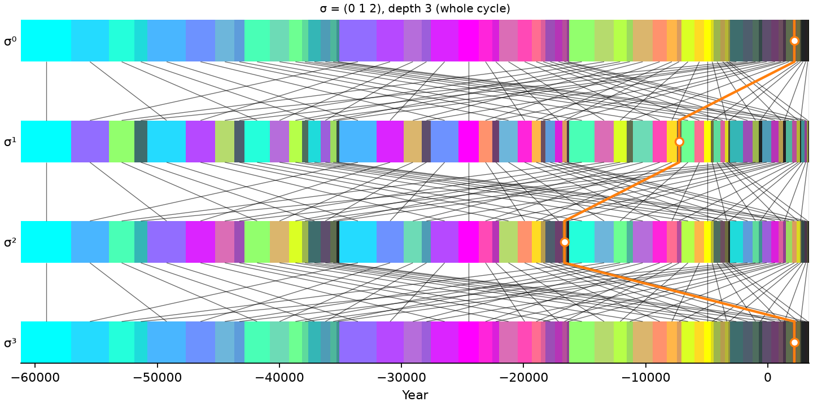

# 3. Permutaciones de las posiciones de los dígitos

## 3.1 La acción

Una permutación $\sigma$ de las $m$ posiciones de los dígitos actúa sobre las direcciones reordenando sus dígitos.
Como la duración solo depende de la composición (capítulo 1), **toda permutación de posiciones conserva las
duraciones**: mueve cada subciclo a otro lugar del ciclo con la misma duración (y la misma composición).

La convención es la de `SymmetricGroup.operation` (paquete `symmetry-math`), que siguen el código y el
explorador:

$$
(a \circ b)_i = a_{b_i} \quad\text{(composición)}, \qquad a \mapsto a \circ \sigma, \quad (a \circ \sigma)_i = a_{\sigma_i}
$$

es decir, el dígito $i$ de la imagen es el dígito $\sigma_i$ del original.

Ejemplo: con el desplazamiento cíclico σ = (1 2 0) (en notación de una línea: la posición 0 toma el dígito de
la 1, la 1 el de la 2 y la 2 el de la 0), Kali › Treta › Dvapara = (3, 1, 2) va a (1, 2, 3) = Treta ›
Dvapara › Kali. En notación de ciclos, σ = (0 1 2).

`cycles.functions.permutation` reúne las operaciones con tuplas: `compose`, `identity`, `power` (σ^r),
`cycles` (los ciclos, con los puntos fijos), `order` (mínimo común múltiplo de las longitudes de los ciclos),
`sign` (paridad), `cycle_type` (longitudes de los ciclos), `cycle_text` (notación de ciclos, `()` para la
identidad) y `parse_permutation`, que acepta las dos notaciones: `1 2 0`, `1,2,0`, `120`, `(0 1 2)` o
`(01)(23)`.

## 3.2 Sobre qué dígitos actúa

En el explorador, σ actúa sobre los dígitos de una **cola** de la dirección: los que van desde una posición
`first` hasta el final (`permute_digits(lcoords, σ, first)`), dejando fijos los anteriores. Hay dos alcances:

- **Bajo el zoom:** `first` = profundidad del subciclo ampliado. Los subciclos se mueven sin salir de él.
- **Todos los dígitos:** `first` = 0. Los subciclos se mueven por todo el ciclo.

Por ejemplo, con el zoom en Kali y σ = (1 0) sobre los dos últimos dígitos, Kali › Treta › Dvapara va a
Kali › Dvapara › Treta. La posición 0 de σ es siempre el primer dígito sobre el que actúa.

## 3.3 Índices de la imagen y matriz

El índice de la imagen se calcula para todos los subciclos a la vez: si la cola tiene dígitos *a_j*, la imagen
de σ ocupa el lugar

$$
\operatorname{lugar} = \sum_j a_j\, 4^{\,m - 1 - \sigma^{-1}(j)}
$$

así que, para un bloque de permutaciones, los lugares son un solo producto de matrices (lo usa el explorador
de grupo). `permutation_matrix(σ, lcoords)` construye la matriz de permutación de la acción sobre un nivel:
`M[nuevo, viejo] = 1`.

## 3.4 Potencias, órbitas y puntos fijos

Las potencias σ⁰ = identidad, σ¹, σ², … vuelven a la identidad tras el **orden** de σ. La **órbita** de un
subciclo bajo ⟨σ⟩ es el conjunto de lugares por los que pasa: el explorador la resalta (modo *⟨σ⟩ orbit*) y
dibuja los recorridos en el panel de permutaciones.

**Puntos fijos.** $\sigma$ deja fijo un subciclo si sus dígitos son constantes en cada ciclo de $\sigma$: hay $4^{c(\sigma)}$,
siendo $c(\sigma)$ el número de ciclos de $\sigma$ (puntos fijos incluidos).

**Número de órbitas (lema de Burnside).** Es la media de los puntos fijos de las potencias:

$$
\#\text{órbitas de } \langle\sigma\rangle = \frac{1}{\operatorname{ord}\sigma} \sum_{r=0}^{\operatorname{ord}\sigma - 1} 4^{\,c(\sigma^r)}
$$

| σ (sobre *m* dígitos) | Orden | Fijos | Órbitas |
|---|---|---|---|
| (0 1 2), *m* = 3 | 3 | 4 | (64 + 4 + 4)/3 = 24 |
| (0 1 2 3), *m* = 4 | 4 | 4 | (256 + 4 + 16 + 4)/4 = 70 |
| (0 3)(1 2), inversión, *m* = 4 | 2 | 16 | (256 + 16)/2 = 136 |
| (0 1), *m* = 4 | 2 | 64 | (256 + 64)/2 = 160 |

Con todo el grupo simétrico $S_m$, la media de los puntos fijos de sus $m!$ elementos es el número de órbitas de
$S_m$, es decir, el de **composiciones**: $\binom{m+3}{3}$ (35 para $m = 4$). Es la misma cuenta del capítulo 1 vista
desde las permutaciones: dos direcciones son ordenaciones una de otra si y solo si tienen la misma composición.

## 3.5 Lo que cambia y lo que no

Una permutación conserva la duración y la composición, pero en general cambia:

- el **lugar en el tiempo** (cuánto se desplaza cada subciclo, y si se respeta el orden temporal);
- el **color** (los pesos por posición cambian de dígito);
- el **dharma** y la **pureza** (por la misma razón; con base 1 no cambiarían).

El **explorador de grupo** del panel de permutaciones (capítulo 12) recorre todos los elementos de S_m y, para
cada uno, da su estructura (ciclos, tipo, orden, paridad, fijos, órbitas) y cómo mueve los subciclos del tramo:
porcentaje movido, desplazamiento medio, correlación del orden temporal, cambio medio de color, de dharma y de
pureza. Se puede ordenar y filtrar, y elegir un elemento lo carga en el panel.

Los paneles *Measures* y *Color space* **unen** los subciclos resaltados alrededor de la selección (capítulo 12):
la órbita de $\langle\sigma\rangle$ con flechas, paso a paso, y las ordenaciones de su composición con una
línea por cada **intercambio de dos dígitos vecinos**. Estas líneas tienen una propiedad sencilla: si se
intercambian las posiciones $k$ y $k+1$, con $\delta = v_{k+1} - v_k$ la diferencia de sus virtudes, el dharma
cambia en $(\hat w_k - \hat w_{k+1})\,\delta$ y la tendencia en $\delta\,(\hat w'_{k-1} - 2\hat w'_k +
\hat w'_{k+1})/\tfrac34$ (2.4; los términos que no existen en los extremos, fuera). Ambos cambios son
proporcionales a $\delta$ con coeficientes que solo dependen de $k$: en el plano tendencia–dharma, todos los
intercambios de una misma posición son **paralelos**, y su longitud es proporcional a lo distintas que sean las
dos edades. Con base 2, el intercambio de los dos últimos dígitos no cambia la tendencia (líneas horizontales).

## 3.6 Ajustes predefinidos del panel

| Nombre | σ (una línea, *m* posiciones) |
|---|---|
| Cyclic shift | (1, 2, …, m−1, 0) |
| Inverse shift | (m−1, 0, 1, …, m−2) |
| Reversal | (m−1, …, 1, 0) |
| Swap the first two | (1, 0, 2, …) |
| Swap the last two | (…, m−1, m−2) |
| Random | una permutación al azar (↻ da otra) |
| Custom | escrita a mano, en cualquiera de las dos notaciones |

## 3.7 Resumen

- σ reordena los dígitos de la cola de cada dirección: a ↦ a ∘ σ.
- Conserva duraciones y composiciones; mueve lugares, colores y medidas.
- En los gráficos de medidas, los intercambios de dígitos vecinos de una misma posición son paralelos.
- Fijos: $4^{c(\sigma)}$. Órbitas de $\langle\sigma\rangle$: media de los fijos de sus potencias (Burnside).
- Las órbitas de todo $S_m$ son las composiciones: $\binom{m+3}{3}$.
