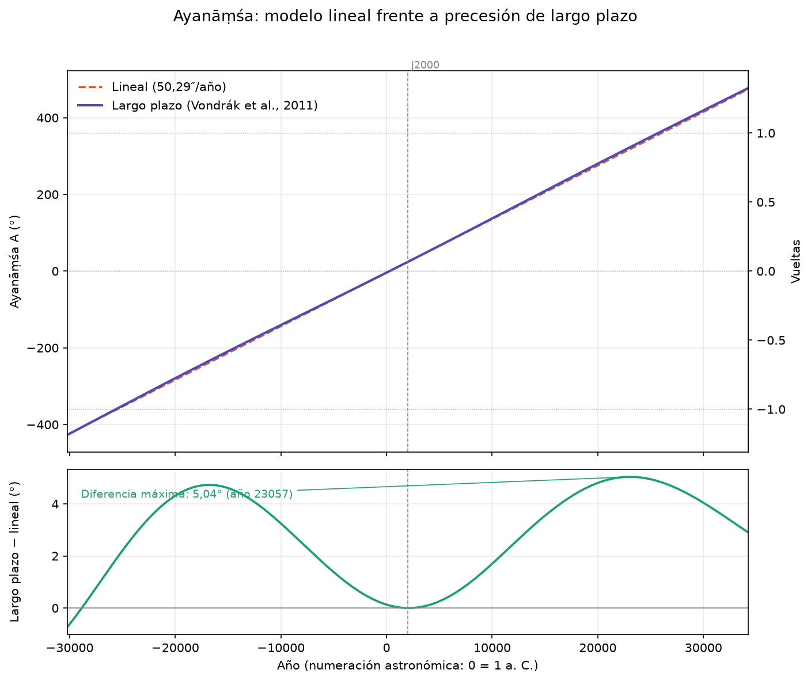
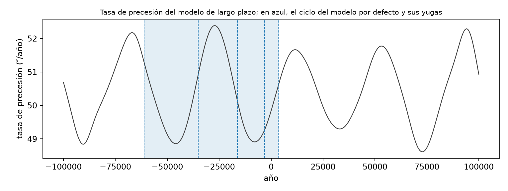
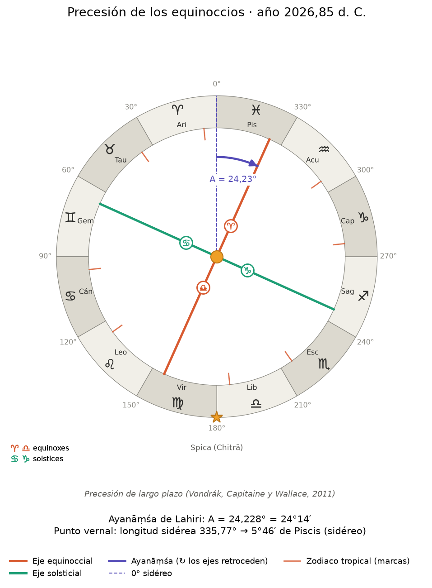

# 4. Precesión de los equinoccios y ayanāṃśa

*Revisión del documento homónimo de `efemerides_precesion_tiempo`, actualizada con el modelo de ciclo y el
explorador.*

## 4.1 El fenómeno

El eje de rotación de la Tierra no apunta siempre al mismo lugar del cielo: describe un cono alrededor de la
perpendicular a la eclíptica. Ese giro, la **precesión lunisolar**, hace que el punto vernal (el cruce del
ecuador celeste con la eclíptica, donde empieza el zodiaco trópico) retroceda sobre la eclíptica. A él se suma
la **precesión planetaria**, un pequeño movimiento del propio plano de la eclíptica por la atracción de los
planetas. El resultado conjunto es la **precesión general**, de unos 50″ por año: una vuelta completa (360°)
en torno a 25 700 años.

El zodiaco **trópico** (doce signos de 30° contados desde el punto vernal de la fecha) se desplaza respecto a
las estrellas; el **sidéreo** (doce signos fijos respecto a las estrellas) no. La diferencia entre ambos es el
**ayanāṃśa**.

## 4.2 Definición de ayanāṃśa usada

- Se mide en grados y se toma **positivo** cuando el punto vernal ha retrocedido respecto al origen sidéreo:
  `longitud sidérea = longitud trópica − A`.
- **No se reduce módulo 360°.** En intervalos largos acumula varias vueltas: un ciclo de 2,5 vueltas recorre
  900° de ayanāṃśa, y los esquemas lo muestran como un arco en espiral.
- Referencia: el **ayanāṃśa de Lahiri** (Chitrapaksha), 23°51′11″ = 23,853° en J2000.0, definido por la estrella
  Spica (Citrā) a 180° sidéreos. Se anula hacia el año 285.

## 4.3 Los dos modelos de A(año)

### Modelo lineal (`lahiri_ayanamsa`)

$$
A(\text{año}) = 23{,}853^\circ + (\text{año} - 2000) \times \frac{50{,}29''}{3600}
$$

Una vuelta son 1 296 000″ / 50,29″/año = **25 770,5 años**. No tiene validez física más allá de unos pocos
milenios: la tasa de precesión varía. Los esquemas lo advierten cuando el año está a más de 6000 años de J2000.

### Modelo de largo plazo (`long_term_ayanamsa`)

Basado en las expresiones de precesión de largo plazo de **Vondrák, Capitaine y Wallace (2011, A&A 534, A22;
corrigendum 2012, A&A 541, C1)**, válidas ±200 000 años alrededor de J2000.0. Los coeficientes se
transcribieron de la biblioteca ERFA (derivada de SOFA, de la IAU) y se contrastaron con ella.

1. El modelo da la posición del **polo de la eclíptica** y del **polo del ecuador medio** en cada fecha.
2. Con ellos se calcula la **longitud eclíptica de la fecha** de una dirección fija de referencia (Spica).
3. Se acumula el cambio continuo desde J2000.0, desenrollando la longitud para no perder vueltas:

$$
A(\text{año}) = 23{,}853^\circ + \left[\lambda_{\text{Spica}}(\text{año}) - \lambda_{\text{Spica}}(2000)\right]
$$

La dirección de referencia es **fija** (sin movimiento propio de Spica). Coincide con la precesión IAU 2006 en
J2000.0; según ERFA, su exactitud es de segundos de arco en el periodo histórico y de décimas de grado en los
extremos. Fuera de ±200 000 años lanza `ValueError`. Es el modelo de precesión por defecto de los modelos de
ciclo (capítulo 8).

## 4.4 Resultados numéricos

Ayanāṃśa en grados, sin reducir, en las fronteras de los yugas del modelo de ciclo por defecto (Kali en la
medianoche del 17/18 de febrero de 3102 a. C. en Ujjain, 2,5 vueltas):

| Año | Largo plazo | Lineal | Comentario |
|---:|---:|---:|---|
| −61 146,5 | −856,626 | −858,27 | inicio del Satya |
| −35 081,4 | −496,626 | −494,15 | inicio del Treta |
| −16 268,2 | −226,626 | −231,34 | inicio del Dvapara |
| −3 100,8 | −46,626 | −47,40 | inicio del Kali (3102 a. C.) |
| 0 | −3,955 | −4,086 | |
| 285,49 | 0,000 | −0,098 | el ayanāṃśa de Lahiri se anula |
| 2000 | 23,853 | 23,853 | ancla |
| 2026,85 | 24,228 | 24,228 | hoy |
| 2439,75 | 30,000 | 29,996 | el punto vernal entra en Acuario |
| 3393,6 | 43,374 | 43,321 | fin del ciclo |

Con el modelo de largo plazo, las fronteras están exactamente a 360°, 270°, 180° y 90° unas de otras: el
modelo de ciclo divide el **arco** (capítulo 8).



- Las dos curvas casi coinciden a esa escala, pero su **diferencia llega a 5,04°** (hacia el año 23 055).
- A = 0° en el año 292,5 (lineal) y **285,5** (largo plazo); A = 30° en 2440,0 y **2439,8**.

### Una vuelta de precesión no dura siempre lo mismo

- Entre **25 268 y 26 115 años** según el punto de partida (media de 25 685 años en ±200 000 años).
- Desde J2000.0 hacia delante: **25 441 años** (año 27 441,0). Hacia atrás: **25 968 años** (año −23 967,6).
- La tasa de precesión oscila entre **48,6 y 52,6″/año**; los 50,29″/año del modelo lineal son la de hoy.

La tasa varía sobre todo con un periodo de unos **41 000 años**, el de la oblicuidad de la eclíptica: la
precesión lunisolar es proporcional al coseno de la oblicuidad. Esta variación es la que separa los dos
criterios de división del ciclo (capítulo 8).



## 4.5 La función inversa

`year_from_ayanamsa(value, unit, reference_year, model, ...)` da el año en que A alcanza un valor. Ambos
modelos crecen estrictamente, así que la solución es única. El lineal se invierte en forma cerrada; el de largo
plazo con una tabla de paso 10 años refinada con iteraciones de Newton (exactitud muy inferior a un día).
Acepta matrices, y es la pieza con la que se calculan las fronteras de los subciclos al dividir el arco.

```python
year_from_ayanamsa(0.0)                                     # 285.49
year_from_ayanamsa(30.0)                                    # 2439.75
year_from_ayanamsa(1, unit="turns", reference_year=2000)    # 27441.0  (una vuelta después de J2000)
year_from_ayanamsa(-1, unit="turns", reference_year=2000)   # -23967.6 (una vuelta antes)
```

- Sin `reference_year`, `value` es el propio A; con ella, el **cambio** de A desde ese año.
- El rango de A en ±200 000 años es de unos −2787° a +2818°.
- `precession_time_map(start, turns)` construye con ella el mapa de tiempo que divide el arco (capítulo 8).

## 4.6 Coordenadas eclípticas de la fecha

`ecliptic_coordinates_of_date(vectors, year, sidereal=False, ...)` convierte direcciones del sistema ICRF (por
ejemplo, las de la efeméride, capítulo 6) en longitud y latitud eclípticas referidas a la **eclíptica y el
equinoccio medios de la fecha**, con el mismo modelo de precesión que el ayanāṃśa.

- Con `sidereal=True` se resta el ayanāṃśa del modelo elegido.
- El marco depende de la época: se pasa el año de cada vector (admite matrices de vectores y de años).
- Las posiciones son **geométricas** (sin tiempo de luz, aberración ni nutación).
- Se validó contra Moshier a unos pocos segundos de arco (capítulo 7).

## 4.7 Cómo leer el esquema



- Vista desde el polo norte de la eclíptica, con 0° arriba y longitudes crecientes en sentido antihorario.
- El **anillo de los signos** (doce de 30°) está fijo: es el zodiaco sidéreo.
- Las rectas roja y verde son los ejes **equinoccial** y **solsticial**. Junto con el zodiaco trópico (marcas
  rojizas en el anillo), **giran en sentido horario** por la precesión. Sus extremos llevan, dentro del círculo,
  los glifos de los equinoccios (♈ ♎) y los solsticios (♋ ♑), con una leyenda en una esquina; los ejes no salen
  del disco interior, de modo que el gráfico no cambia de tamaño al girar.
- El arco morado muestra el ayanāṃśa acumulado (en espiral si supera una vuelta).
- El anillo exterior opcional son los 27 **nakṣatras**, contados desde 0° sidéreo.
- La estrella marca Spica, a 180° sidéreos.

## 4.8 Dónde está hoy el punto vernal

En 2026,85 el punto vernal está a **335,77° sidéreos: 5°46′ de Piscis**. Faltan 5,77° hasta Acuario, que a unos
50,3″/año se recorren en unos 410 años: hacia el año **2440** (A = 30°).

(En la sesión original se dijo por error que faltaban unos 24° y 1700 años: 24° es el valor actual del
ayanāṃśa, no la distancia al límite del signo.)

## 4.9 Límites y precauciones

1. **El modelo lineal no sirve a escala de milenios.**
2. **El de largo plazo se degrada en los extremos** (±200 000 años): décimas de grado.
3. **Dirección fija de Spica**: su movimiento propio se ignora.
4. **No hay un único ayanāṃśa**: los criterios en uso difieren hasta casi 4° (capítulo 7). Aquí se usa Lahiri
   anclado en 23,853° en J2000.0 (`j2000_ayanamsa_deg` permite cambiarlo).
5. **El año decimal no es el 1 de enero** (capítulo 5): las fechas se convierten con `astro_dates`.
6. **Geométrico, no aparente**: no se aplican nutación (~17″) ni aberración (~20″).
7. **Precesión y yugas**: con la tasa variable, 4:3:2:1 en arco y 4:3:2:1 en años no coinciden (capítulo 8).
