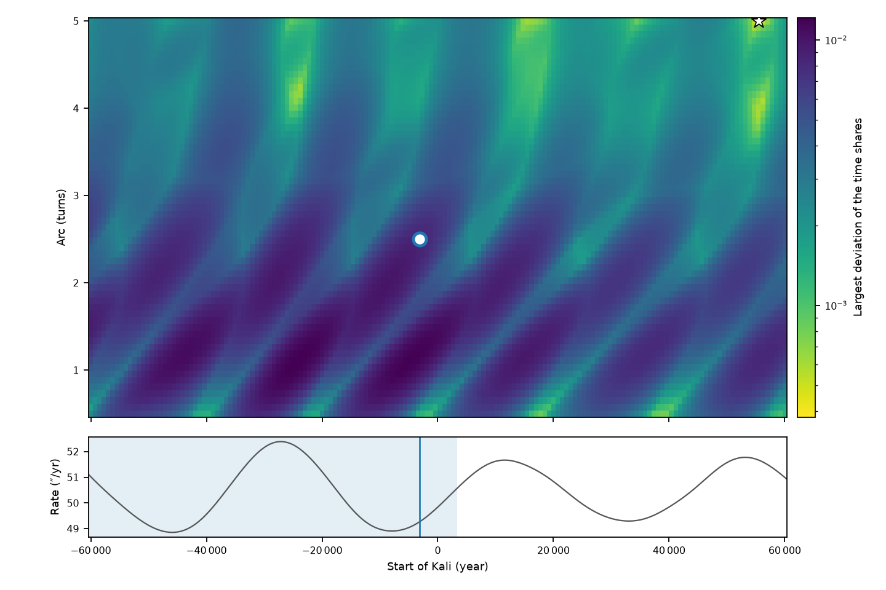

# 8. El modelo de ciclo

## 8.1 Del tiempo normalizado a los años

La división trabaja en [0, 1). Un **mapa de tiempo** (`TimeMap`, `cycles.functions.timescale`) lleva el tiempo
normalizado a tiempo físico (años decimales, UT) y viceversa, y da el inicio y el fin físicos de cualquier
subciclo (`interval`) o el subciclo que contiene una fecha (`subcycle_at`):

| Mapa | Divide | Uso |
|---|---|---|
| `TimeMap.linear(inicio, fin)` | el tiempo, uniformemente | edades exactamente 4:3:2:1 en años |
| `TimeMap.from_age_boundaries([...])` | el tiempo, ajustado a 5 fronteras dadas | cada edad se ajusta a sus fechas; lineal dentro |
| `precession_time_map(inicio, vueltas)` | el **ángulo de precesión** | toda frontera de subciclo es una frontera de precesión |

El tercero se construye con `TimeMap.from_functions` a partir de una función creciente y su inversa: el tiempo
normalizado $u$ corresponde al instante en que el punto vernal ha recorrido la fracción $u$ del arco total, que
se obtiene invirtiendo el ayanāṃśa (`year_from_ayanamsa`, capítulo 4).

## 8.2 Las elecciones de un modelo

Cómo encaja el ciclo de los yugas en la historia es una **pregunta abierta**: las fuentes discrepan sobre el
momento en que empieza el Kali y sobre la longitud del ciclo. Un `CycleModel` (`cycles.functions.cycle_model`)
hace explícita cada elección:

| Campo | Significado |
|---|---|
| **ancla** | un instante, como fecha y hora (hora media local en una longitud, o UT) o como un valor del ayanāṃśa, y el **punto del ciclo** que cae en él: inicio del Satya, del Treta, del Dvapara o del Kali, o el final |
| **escala** | el arco total en vueltas, o la longitud en años (una determina la otra) |
| **división** | qué divide 4:3:2:1 en cada nivel: el **ángulo** (`'angle'`), el **tiempo** (`'time'`), o el ángulo para los yugas y el tiempo dentro de ellos (`'hybrid'`) |
| **precesión** | el modelo de largo plazo (tasa variable) o una tasa constante dada por su periodo |

`model.solve()` da inicio, fin, vueltas, años y ancla; `model.time_map()` el mapa de tiempo que usa todo lo
demás; `model.boundaries()` los años de las cinco fronteras. Los puntos del ciclo están en `ANCHOR_POINTS`
(Satya 0, Treta 0,4, Dvapara 0,7, Kali 0,9, fin 1).

Para resolver: con división por ángulo, el ciclo empieza `u·vueltas` antes del ancla en arco y termina
`(1 − u)·vueltas` después (si se da la longitud en años, se busca por bisección el arco que la produce); con
división por tiempo, el ciclo son años lineales y, si se dan vueltas, se busca por bisección la longitud en años
cuyo arco es ese.

## 8.3 El arco en vueltas

Con 2,5 vueltas (900°), cada yuga ocupa 4:3:2:1 del arco, las mismas cuotas que en años: 0,4, 0,3, 0,2 y 0,1.
El Satya es exactamente una vuelta del punto vernal alrededor del zodiaco:

| Yuga | Arco | Grados | Cuota de las 2,5 vueltas |
|---|---|---|---|
| Satya | 1 vuelta | 360° | 1 / 2,5 = 0,4 |
| Treta | ¾ de vuelta | 270° | 0,75 / 2,5 = 0,3 |
| Dvapara | ½ vuelta | 180° | 0,5 / 2,5 = 0,2 |
| Kali | ¼ de vuelta | 90° | 0,25 / 2,5 = 0,1 |

La división se repite en cada nivel: el arco de un subciclo es el total por el producto de las cuotas de su
dirección. Kali › Kali es $2{,}5 \cdot 0{,}1 \cdot 0{,}1 = 0{,}025$ vueltas (9°); Satya › Kali,
$2{,}5 \cdot 0{,}4 \cdot 0{,}1 = 0{,}1$ vueltas (36°). Por eso el preset de tasa constante da al Satya un periodo de precesión (25 772 años).

## 8.4 Los presets

| Preset | Ancla (inicio del Kali) | En UT | Escala |
|---|---|---|---|
| Kali 3102 BC, midnight at Ujjain (**por defecto**) | medianoche del 17/18 feb 3102 a. C. en Ujjain (Sūrya Siddhānta; sistema de medianoche de Āryabhaṭa) | 17 feb 3102 a. C., 18:57 | 2,5 vueltas |
| Kali 3102 BC, sunrise at Lanka | salida media del Sol del 18 feb 3102 a. C. en el meridiano de Ujjain (sistema de salida del Sol) | 18 feb 3102 a. C., 00:57 | 2,5 vueltas |
| Kali 3104 BC, Abhyankar 1993 | salida del Sol en Ujjain, 7 feb 3104 a. C. (Bull. Astr. Soc. India 21, 475) | 7 feb 3104 a. C., 01:51 | 2,5 vueltas |
| Precession period at constant rate | como el de defecto | | 64 430 años (Satya = 25 772 años) |

El modelo por defecto va de **−61 146,5** (inicio del Satya) a **3393,6** (fin): 64 540,1 años. Los presets que
se guardan (desde el explorador o con `save_user_presets`) van a `sandbox/cycle_presets.json`, o a
`$CYCLES_PRESETS`.

## 8.5 Dos criterios que no pueden cumplirse a la vez

Con tasa de precesión variable, «4:3:2:1 del arco» y «4:3:2:1 de los años» no coinciden. Al **dividir el
arco**, las fronteras son los instantes exactos en que el punto vernal ha recorrido cada cuota (invirtiendo el
modelo de precesión: la tasa cuenta en cada instante, no mediante promedios). Como consecuencia, la cuota de
tiempo de un yuga es su cuota de arco por la tasa media del ciclo entre la tasa media del yuga (tasa media =
arco ÷ tiempo, una **identidad exacta**, no una aproximación):

$$
\frac{\Delta t_{\text{yuga}}}{\Delta t_{\text{ciclo}}} = \frac{\Delta\theta_{\text{yuga}}}{\Delta\theta_{\text{ciclo}}}
\cdot \frac{\bar\omega_{\text{ciclo}}}{\bar\omega_{\text{yuga}}}, \qquad
\bar\omega = \frac{\Delta\theta}{\Delta t} = \frac{1}{\Delta t}\int \omega(t)\, dt
$$

Usar la tasa *en* un instante (por ejemplo, en el centro de cada yuga) sería una aproximación peor: la tasa
cambia unos 4″/año a lo largo de un yuga. La forma exacta es $\Delta t = \int d\theta / \omega(\theta)$, que es justo lo
que calcula la inversión del ayanāṃśa.

Con el modelo por defecto (tasas medias en ″/año: ciclo 50,201; Satya 49,722; Treta 51,666; Dvapara 49,213;
Kali 49,889), los yugas ocupan **0,4039, 0,2915, 0,2040 y 0,1006** del tiempo: por ejemplo,
$0{,}4 \cdot 50{,}201 / 49{,}722 = 0{,}4039$.

Dividir los **años** en lugar del arco (mismo ancla y mismo arco total) mueve las fronteras: el Treta empezaría
en −35 370,6 en lugar de −35 081,4 (**289 años antes**), el Dvapara en −16 008,7 en lugar de −16 268,2. El modo
híbrido coincide con el ángulo en las fronteras de los yugas y divide los años dentro de ellos.

## 8.6 El desajuste por profundidad

`cycle_analysis.mismatch_by_depth(model, d)` mide, en cada profundidad, cuánto se apartan de 0,4, 0,3, 0,2 y 0,1
las cuotas de tiempo de las cuatro partes de cada subciclo cuando se divide el arco: la mayor desviación y la
cuadrática media.

| Profundidad | 1 | 2 | 3 | 4 | 5 |
|---|---|---|---|---|---|
| Mayor desviación | 0,0085 | 0,0047 | 0,0050 | 0,0021 | 0,0009 |
| Cuadrática media | 0,0051 | 0,0023 | 0,0012 | 0,0004 | 0,0001 |

Dentro de los yugas la desviación se reduce con la profundidad: los subciclos son cortos frente a la variación
de la tasa. En el explorador, el conmutador *Criteria* del navegador dibuja dónde pone las fronteras el otro
criterio (capítulo 12): las de los yugas difieren hasta unos 300 años; dentro del Kali, por ejemplo, Kali ›
Dvapara empezaría 6,4 años antes dividiendo los años.

## 8.7 Ajustar el ancla y el arco

`fit_anchor(model, anchor_range, turn_range, depth, step, turn_step)` busca en una rejilla el ancla (y,
opcionalmente, el arco) que minimiza la mayor desviación a una profundidad, y refina dos veces alrededor del
mejor punto. Devuelve el modelo ajustado, su desajuste, el del modelo de partida y la rejilla.

- Con el arco fijo en 2,5 vueltas, el ancla tradicional está **cerca de una de las peores** colocaciones
  (desviación 0,0085, frente a unos 0,002 en las mejores): el Treta cubre entonces el máximo de la tasa y el
  Dvapara su mínimo. Entre −30 000 y +30 000, el mejor inicio del Kali sería el año 24 782 (0,0020).
- Con el arco libre, la búsqueda tiende al **arco más largo permitido**, porque un ciclo más largo promedia la
  variación de la tasa (con arcos de 1 a 4 vueltas: 4 vueltas, 0,0009).

El diálogo del modelo del explorador ofrece cuatro búsquedas (*Best fit*): ancla con el mismo arco (de 100 000
a. C. a 100 000 d. C.), ancla a menos de 2000 años de la actual, ancla y arco (1 a 5 vueltas) y solo arco.

## 8.8 El paisaje del modelo y su periodo de 20 000 años

El panel *Model landscape* dibuja el desajuste para cada ancla y cada arco (`mismatch_grid`), con el modelo
actual como un punto que se puede arrastrar (capítulo 12).

El acuerdo sube y baja **cada unos 20 000 años** al desplazar el ancla, para cualquier arco. Ese periodo viene
del **modelo de precesión, no de la división**:

1. La tasa varía sobre todo con la oblicuidad, con un periodo de unos **41 000 años** (picos de la tasa cada
   36 000–46 000 años en ±150 000 años).
2. La cuota de cada yuga se desvía en un sentido mientras la tasa sube y en el otro mientras baja: la desviación
   con signo del Treta sigue el periodo de 41 000 años y **cambia de signo cada unos 20 000 años** (separaciones
   medidas: 21 100, 21 500, 20 100, 20 400, 19 900, 20 000, 19 500 y 20 300 años).
3. La mayor desviación ignora el signo, así que alcanza un máximo **dos veces por periodo**: unos 20 000 años.
   Es igual con 1, 2,5 y 4 vueltas.

Las pruebas `tests/test_landscape.py` comprueban las tres cosas.

## 8.9 Resumen

- Un modelo fija ancla, escala, división y precesión; todo lo demás usa su mapa de tiempo.
- Con 2,5 vueltas, el Satya es una vuelta; con tasa variable, las cuotas de tiempo son 0,4039, 0,2915, 0,2040 y
  0,1006.
- La identidad de las tasas medias es exacta: explica el desajuste, no lo aproxima.
- El ancla tradicional está cerca del peor desajuste para 2,5 vueltas; el periodo de 20 000 años del paisaje
  es la variación de 41 000 años de la tasa, rectificada.
