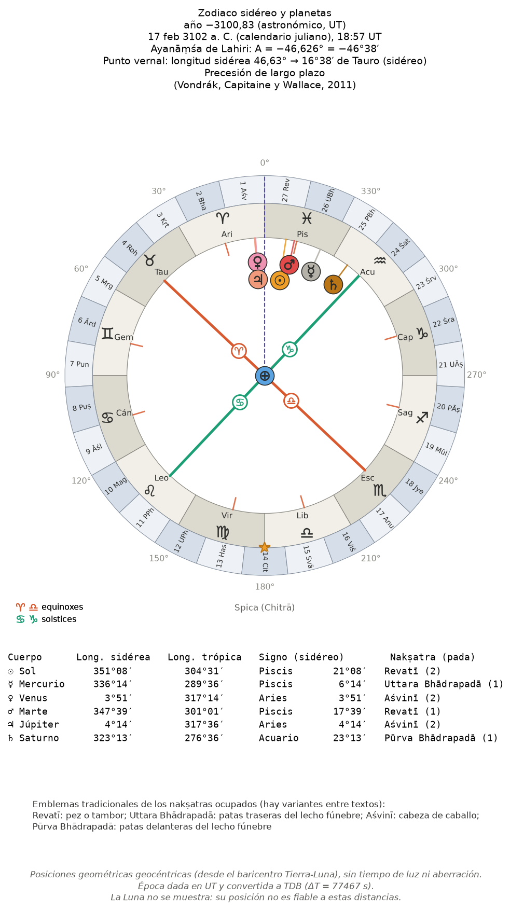
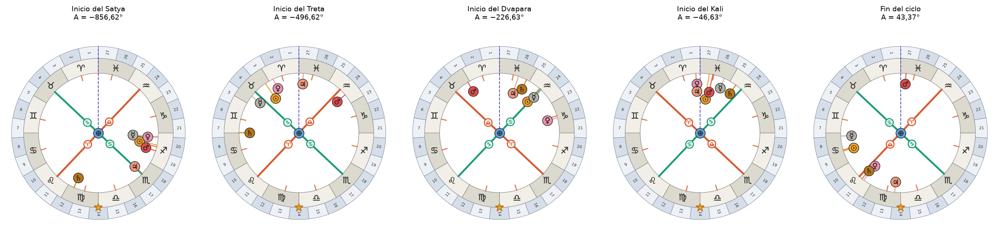

# 10. Arquitectura y guía de los módulos

## 10.1 Vista general

```
cycles/
  functions/   cálculo (NumPy; sin interfaz)
  plotting/    figuras con Matplotlib, un módulo por tema
  gui/         el explorador gráfico (PySide6), capítulo 12
sandbox/       estudios, uno por tema (capítulo 11); data/, plots/, docs/, sessions/ no se versionan
docs/es/       esta documentación: capítulos Markdown, figuras, generador del LaTeX
tests/         pruebas con pytest (capítulo 13)
pyproject.toml metadatos, dependencias, la orden cycles-gui, configuración de pytest
```

Instalación (Python 3.11 o posterior):

```bash
python -m venv .venv && source .venv/bin/activate
pip install -e ".[all]"            # núcleo + astro + sound + gui; ".[test]" añade pytest
```

| Extra | Añade | Para |
|---|---|---|
| (núcleo) | NumPy, Matplotlib, `papersize`, `symmetry-math` | todo el cálculo y las figuras |
| `astro` | REBOUND, REBOUNDx | construir la efeméride |
| `sound` | PyWavelets, sounddevice | escalogramas y reproducción |
| `gui` | PySide6 | el explorador |
| `test` | pytest | las pruebas |

Convenciones: identificadores y salida de los programas en inglés (salvo algunos textos de los esquemas del
zodiaco, en español); años en numeración astronómica; tiempos normalizados en [0, 1). Todas las funciones
tienen docstrings (`help(compute_level)`).

## 10.2 `cycles.functions`

| Módulo | Contenido principal |
|---|---|
| `division.py` | proporciones y desplazamientos; `Level` y `compute_level`; `compute_duration`, `compute_start`, `find_lcoords`, `select_subcycle`, `partition_level`, `fill_partition`; colores (`level_colors`, `COLOR_KEYS`), parámetros por defecto y sus efectos (capítulos 1 y 2) |
| `conversion.py` | dirección ↔ índice ↔ fracción en base *b* |
| `composition.py` | composiciones, clases de igual duración, enumeración de una composición, `analyse_level` |
| `duration.py` | `count_digits`, `same_duration`, `duration_quotient`, distancias entre inicios |
| `measure.py` | `dharma_measure`, `purity_measure`, `dharma_from_cmyk`; las demás medidas (`mixture_measure`, `tension_measure`, `trend_measure`, `roughness_measure`, `contrast_measure`, `balance_measure`), `address_measures` y el registro `MEASURES` |
| `color.py` | variantes CMYK, CMYK → RGB, `lrgb`, coloreado del tetraedro en RGB y en OKLab (`srgb_to_oklab`, `oklab_to_srgb`, `oklab_tetrahedron`), colores por clase de duración, por medida (`measure_colors`) y por el punto vernal (`vernal_colors`), rangos de los parámetros (`color_parameter_problems`) |
| `permutation.py` | matriz de una permutación sobre un nivel; composición, potencias, ciclos, orden, signo, tipo, notación, `parse_permutation`, `permute_digits`, `tcoords_of` (capítulo 3) |
| `timescale.py` | `TimeMap` (lineal, por fronteras de edades, por funciones), `address_label`, nombres de las edades |
| `cycle_model.py` | `CycleModel`, presets y su fichero, `mean_rate` (capítulo 8) |
| `cycle_analysis.py` | cuotas de tiempo, desviaciones, `mismatch_by_depth`, `mismatch_grid`, `fit_anchor`, `precession_rate` |
| `events.py` | acontecimientos planetarios: conjunciones exactas y sus series, signos y elementos en ambos zodiacos, cambios de trígono, cuerpos alrededor de un punto (capítulo 15) |
| `significance.py` | contrastes: distancia al acontecimiento más cercano, rotaciones rígidas, valores p, corrección de Holm |
| `astro_dates.py` | calendarios, día juliano, año decimal, ΔT, UT ↔ TDB (capítulo 5) |
| `nbody_ephemeris.py` | construir y consultar la efeméride, escalar y vectorizado (capítulo 6) |
| `sound.py` | tonos y síntesis por ondículas a partir de los colores; escalogramas (`compute_scalogram`, `plot_scalogram`) |
| `analysis.py` | autocorrelación |
| `view.py` | ángulos de cámara de Matplotlib 3D para mirar a lo largo de un eje (`camera_view_angles`, `top_view`, `side_view`) |

### Ejemplos

```python
from cycles.functions.division import compute_level, level_colors
level = compute_level(4)                       # 256 subciclos en orden temporal
level.durations[216], level.starts[216]        # Kali › Treta › Dvapara › Satya: 0.0024, 0.961
level_colors(level)['tetrahedron']             # colores (256, 3)

from cycles.functions.cycle_model import load_presets
model = load_presets()['Kali 3102 BC, midnight at Ujjain']
time_map = model.time_map()
time_map.interval([3, 1])                      # años de Kali › Treta
time_map.subcycle_at(2026.8, 4)                # el subciclo de profundidad 4 que contiene una fecha
```

## 10.3 `cycles.plotting`

| Módulo | Figuras |
|---|---|
| `helpers.py` | `format_plot`: tamaño de papel y guardado (`fig_data` = papel, orientación, ruta, ppp, `tight_layout`) |
| `generic.py` | series y rejillas de gráficos, autocorrelaciones |
| `sector.py` | diagramas de anillos de los subciclos y comparaciones |
| `partition.py` | anillos de las particiones de `fill_partition` |
| `color.py` | barras de niveles; CMYK, RGB, HSV y HLS frente a tiempo o índice; nubes y caminos 3D en el cubo RGB |
| `measure.py` | dharma y pureza (frente a índice, entre sí, en 3D, en rejilla) |
| `duration.py` | barras, recuentos, líneas de tiempo y «trígrafos» de las duraciones por niveles |
| `permutation.py` | matrices de permutación y líneas de tiempo de las permutaciones |
| `cycle_model.py` | tasa de precesión a lo largo del ciclo, desviaciones por profundidad, barridos del ajuste |
| `equinoctial_precession.py` | ayanāṃśa, coordenadas de la fecha, mapa de tiempo por arco, posiciones de planetas y los esquemas del zodiaco |

### Los esquemas del zodiaco

| Función | Dibuja |
|---|---|
| `plot_equinoctial_precession(year, ...)` | zodiaco sidéreo con los ejes equinoccial y solsticial de un año |
| `plot_zodiac_with_planets(year, tablas, ...)` | lo mismo con los planetas de la efeméride |
| `plot_zodiac_planets_grid(years, tablas, ...)` | varios años lado a lado, con tabla resumen opcional |
| `plot_ayanamsa_comparison(...)` | A(t) con los dos modelos, su diferencia y la tasa |

Devuelven `(figura, ejes, datos)` y aceptan `save_path`, `show` y `dpi`. Opciones principales:

| Opción | Valores | Efecto |
|---|---|---|
| `model` | `"long_term"`, `"linear"` | modelo de ayanāṃśa |
| `time_scale` | `"TDB"` (def.), `"UT"` | escala del año de entrada (planetas y rejilla) |
| `bodies` | nombres de la tabla | planetas que se dibujan (por defecto Sol a Saturno; también Urano, Neptuno, Plutón) |
| `nakshatras` | booleano | anillo de los 27 nakṣatras |
| `sign_labels` | `"both"`, `"text"`, `"symbol"` | glifo y nombre de los signos |
| `axis_labels` | `"inner"` (def.), `"outer"` | glifos ♈ ♎ ♋ ♑ junto al centro, con los ejes limitados al anillo de los signos y una leyenda en una esquina; o los nombres en los extremos de los ejes (solo en `plot_equinoctial_precession`) |
| `epoch_display` | `("year",)`, `"date"`, `"julian_day"`, `()` | qué se muestra de la época |
| `epoch_position` | `"title"`, `"center"` | época bajo el título o en el centro |
| `compact` | booleano | versión de panel pequeño (la de la rejilla y el explorador) |
| `table` | booleano | tabla de longitudes, signos y nakṣatras |
| `extra_points` | `{"Luna": 123.4}` | longitudes aportadas (la Luna no se calcula) |
| `ax` | ejes polares | dibujar en unos ejes existentes |

Planetas: discos de color con su símbolo, en su longitud sidérea; si se solapan se reparten a radios distintos.
La tabla da longitud sidérea y trópica, signo con grados y nakṣatra con su *pada*.





```python
import cycles.functions.nbody_ephemeris as nbe
from cycles.gui.sky import ephemeris_parts, DEFAULT_TABLE
from cycles.plotting.equinoctial_precession import plot_zodiac_planets_grid
from cycles.functions.cycle_model import load_presets

tablas = [nbe.load_ephemeris(p) for p in ephemeris_parts(DEFAULT_TABLE)]   # atrás y adelante
fronteras = load_presets()['Kali 3102 BC, midnight at Ujjain'].boundaries()
plot_zodiac_planets_grid(list(fronteras), tablas, time_scale='UT', table=False,
                         labels=['Inicio del Satya', 'Inicio del Treta', 'Inicio del Dvapara',
                                 'Inicio del Kali', 'Fin del ciclo'])
```

## 10.4 `cycles.gui`

El explorador (capítulo 12) está organizado alrededor de un **estado compartido** (`state.CycleState`): el
modelo, el zoom, la selección, el coloreado, la fecha marcada, el momento del cielo, el resaltado, la σ de las
permutaciones, los marcadores y las notas. Las vistas lo leen y lo cambian, y se avisan con señales Qt
(`focusChanged`, `selectionChanged`, `viewChanged`, `modelChanged`, `dateChanged`, `skyTimeChanged`,
`permutationChanged`, `bookmarksChanged`…). `LevelCache` guarda los niveles y sus colores con los parámetros
de color actuales.

| Módulo | Contenido |
|---|---|
| `__main__.py`, `app.py` | entrada y ventana principal: barra de herramientas, menús, paneles, guardar gráficos y sesiones |
| `state.py` | estado compartido, caché de niveles, utilidades (fechas, clases, órbitas, desglose de medidas) |
| `navigator.py` | navegador: franja del ciclo, filas de subdivisiones, marcadores, criterios, marcadores de usuario |
| `inspector.py`, `datepanel.py`, `notes.py` | paneles de texto: subciclo, fecha, notas y marcadores |
| `sky.py`, `skycompare.py`, `eventspanel.py` | cielo de un instante; comparación de cielos; acontecimientos planetarios y su significación |
| `measures.py`, `colorspace.py`, `permutations.py`, `groupexplorer.py`, `compositions.py`, `landscape.py` | paneles de gráficos |
| `modeldialog.py`, `colordialog.py`, `export.py`, `studies.py`, `dossier.py` | diálogos: modelo, colores, guardar gráfico, estudios, dosier |
| `session.py`, `layouts.py` | sesiones; colocación de los paneles |

Los paneles de Matplotlib comparten un patrón: redibujan con un temporizador que agrupa cambios, solo cuando
están visibles (marcan `_dirty` si no), y emiten `saveRequested` desde su botón *Save…*.

## 10.5 Versiones

El programa sigue la **numeración semántica** MAJOR.MINOR.PATCH: mientras esté por debajo de 1.0, una función nueva
sube MINOR y una corrección sube PATCH. La versión tiene **una sola fuente**, `cycles.__version__`
(`cycles/__init__.py`), que leen `pyproject.toml` (`dynamic = ["version"]`), el explorador (título de la ventana y
*Help → About*), las sesiones y los dosieres (que la registran junto al commit de git) y estos documentos.

**Programa y documentos van a la par.** El índice (capítulo 00) declara la versión que documenta, con la línea
«Versión del programa documentada: **X.Y.Z**», y la portada del documento LaTeX la muestra. Dos comprobaciones lo
garantizan:

- `md_a_tex.py` se niega a generar el LaTeX si la versión de los documentos no es la del programa (salvo con
  `--forzar`);
- `tests/test_version.py` falla si no coinciden, y comprueba además que `pyproject.toml` lee la versión del
  paquete y que el `CHANGELOG.md` empieza por ella.

Para publicar una versión: describirla en `CHANGELOG.md`, subir `__version__`, actualizar los capítulos afectados y su
línea de versión, regenerar el LaTeX y etiquetar el commit `vX.Y.Z`. Con una instalación editable,
`pip install -e . --no-deps` refresca la versión de los metadatos instalados.

| Versión | Fecha | Contenido |
|---|---|---|
| 0.3.0 | 2026-11-08 | acontecimientos planetarios y contrastes de significación: cálculo, estudio y panel *Events*; mapa sobre todos los modelos; H1 con los planetas medios; más medidas de los subciclos; fórmulas en LaTeX |
| 0.2.0 | 2026-11-07 | el explorador, el modelo de ciclo, sesiones, marcadores, dosier, disposición de paneles, consultas vectorizadas, pruebas, esta documentación |
| 0.1.0 | 2026-11-05 | la biblioteca de cálculo y los estudios del sandbox |

