# 12. La aplicación gráfica: el explorador

```bash
pip install -e ".[gui]"
cycles-gui                 # o: python -m cycles.gui
```

La interfaz está en inglés. Este capítulo describe cada parte con los nombres que se ven en pantalla.

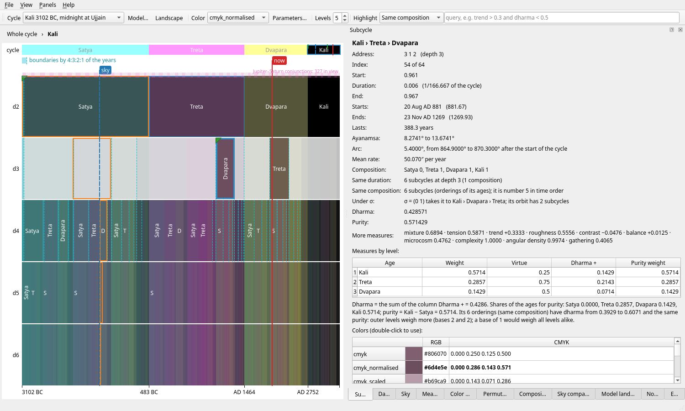

## 12.1 El navegador

El área central muestra las subdivisiones del subciclo ampliado (el **zoom**), una fila por profundidad, cada
subciclo con su color. Arriba, una franja con el **ciclo completo**, con la parte ampliada enmarcada, la fecha
marcada y el momento del cielo; pulsar una edad en ella amplía esa edad. Entre la franja y las filas hay una
**banda de etiquetas** con las de la fecha (*now* o la fecha, en rojo) y el momento del cielo (*sky*, en azul).

| Acción | Efecto |
|---|---|
| clic | selecciona el subciclo |
| doble clic | amplía ese subciclo |
| clic derecho | reduce un nivel |
| ← → | subciclo anterior o siguiente |
| ↑ / ↓ | padre / primera parte |
| Intro / Retroceso | ampliar / reducir |
| Mayús + clic | lleva el momento del cielo a ese instante |
| arrastrar una etiqueta | mueve la fecha o el momento del cielo (Escape cancela) |
| ruta de arriba (*Whole cycle › Kali*) | vuelve a cualquier nivel exterior |

Debajo de las filas, un eje con años o fechas (con un modelo de ciclo). La descripción emergente de un subciclo
da su nombre, sus fechas y duración, con los criterios activados la fecha en que empezaría según el otro
criterio, y sus marcadores.

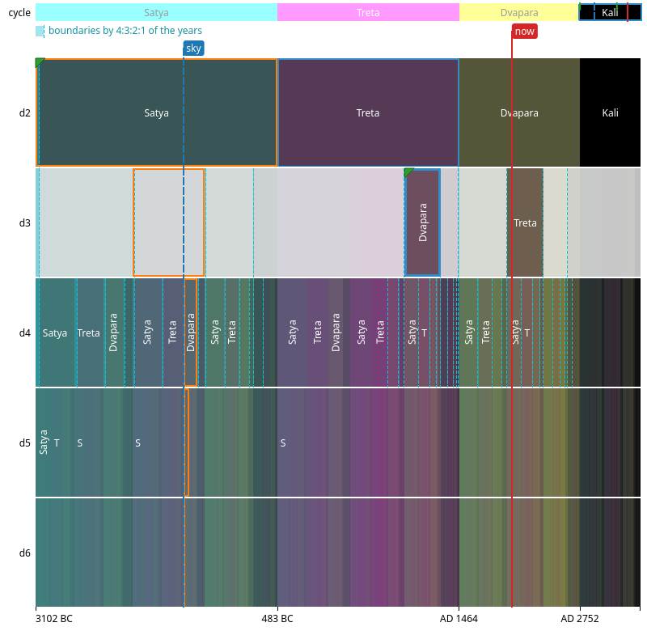

### La barra de herramientas

| Control | Qué elige |
|---|---|
| *Cycle* | el modelo de ciclo (un preset, uno modificado, o tiempo normalizado) |
| *Model…* | el editor del modelo (12.13) |
| *Landscape* | abre el panel *Model landscape* |
| *Color* y *Parameters…* | el coloreado (los veintiuno de `COLOR_KEYS`, en tres grupos: de la dirección, de las medidas y del modelo de ciclo, con la descripción de cada uno al pasar por encima; los del modelo, en gris sin modelo) y sus parámetros (12.14) |
| *Levels* | cuántas filas se dibujan bajo el zoom (1 a 6) |
| *Widths* | anchura por duración (el eje es el tiempo) o igual para todos (el eje es el índice) |
| *Names* | yugas (Satya…) o edades (Golden…) |
| *Labels* | nombres (verticales en celdas altas y estrechas), puntos (4 Satya, 3 Treta, 2 Dvapara, 1 Kali), ambos o ninguno |
| *Borders* | borde en cada celda |
| resaltado | alrededor de la selección, los subciclos de su profundidad con la misma duración, la misma composición o su órbita bajo ⟨σ⟩ (con su imagen por σ en púrpura discontinuo); los demás se atenúan en el navegador y los resaltados se rodean en los gráficos |
| *Criteria* | dibuja dónde pondría las fronteras el criterio que no es la división del modelo (4:3:2:1 del arco o de los años): discontinuas, con el hueco hasta la frontera propia sombreado, en las filas cuyas celdas tienen unos píxeles de ancho (capítulo 8) |

## 12.2 *Subcycle*: el inspector

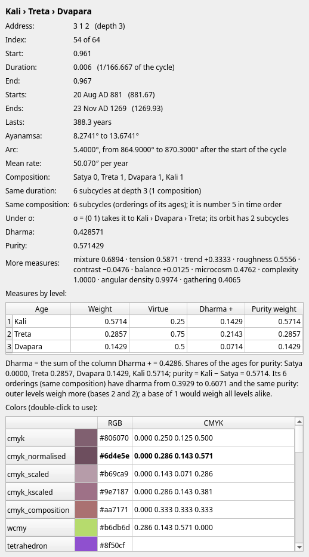

Todo lo que se sabe del subciclo seleccionado: dirección, índice, inicio, duración y fin normalizados; con un
modelo, fechas de inicio y fin, duración en años, ayanāṃśa al inicio y al final, arco (y su lugar en el arco del
ciclo) y tasa media de precesión; composición; cuántos subciclos comparten su duración y su composición (y su
lugar en el tiempo entre estos); su imagen por la σ del panel de permutaciones y el tamaño de su órbita; dharma y
pureza, y en una línea (*More measures*) las demás medidas de 2.4 (la densidad angular, solo con un modelo). La tabla *Measures by level* desglosa ambas medidas (capítulo 2). Al final, su color en los veintiún
coloreados, con RGB y CMYK (los del modelo de ciclo dicen *needs a cycle model* sin él); doble clic en una fila usa
ese coloreado.

## 12.3 *Date*

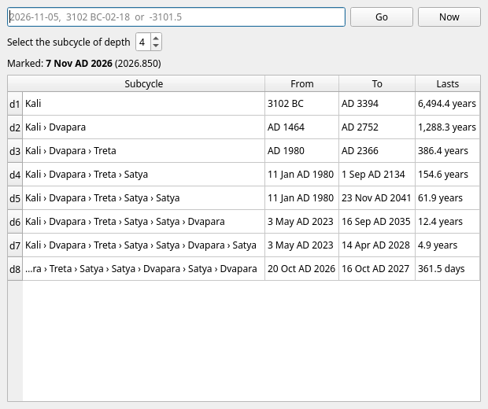

Se escribe una fecha (`2026-11-05`, `3102 BC-02-18`) o un año decimal (`-3101.5`) y *Go* la marca (la línea roja
del navegador) y selecciona el subciclo que la contiene, a la profundidad elegida en *Select the subcycle of
depth*; *Now* vuelve a la fecha actual. La tabla da el subciclo que la contiene en cada profundidad, con su
inicio, su fin y su duración; pulsar una fila lo selecciona.

## 12.4 *Sky*

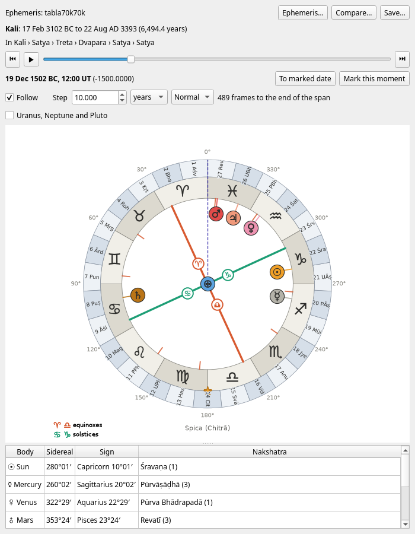

El zodiaco con los planetas (como en `study_of_precession`) en un **momento** del tramo ampliado, con una tabla de
longitudes sidéreas, signos y nakṣatras. El momento es la línea azul discontinua del navegador:

- el deslizador lo mueve por el tramo; Mayús + clic en el navegador o arrastrar la etiqueta *sky* lo llevan a
  cualquier sitio;
- el botón de reproducción lo avanza hasta el final del tramo con un paso (años, días u horas por fotograma; se
  indican los que quedan) y una velocidad;
- *To marked date* lo lleva a la fecha marcada, y *Mark this moment* hace lo contrario;
- con *Follow*, cada gráfico resalta en **naranja** su subciclo que contiene el momento (cada fila del
  navegador a su profundidad, el punto de los gráficos de medidas y de color); la selección (azul) no cambia;
- la casilla *Uranus, Neptune and Pluto* añade los planetas exteriores;
- *Ephemeris…* elige la carpeta de las tablas (capítulo 6); *Compare…* abre *Sky comparison*.

## 12.5 *Sky comparison*

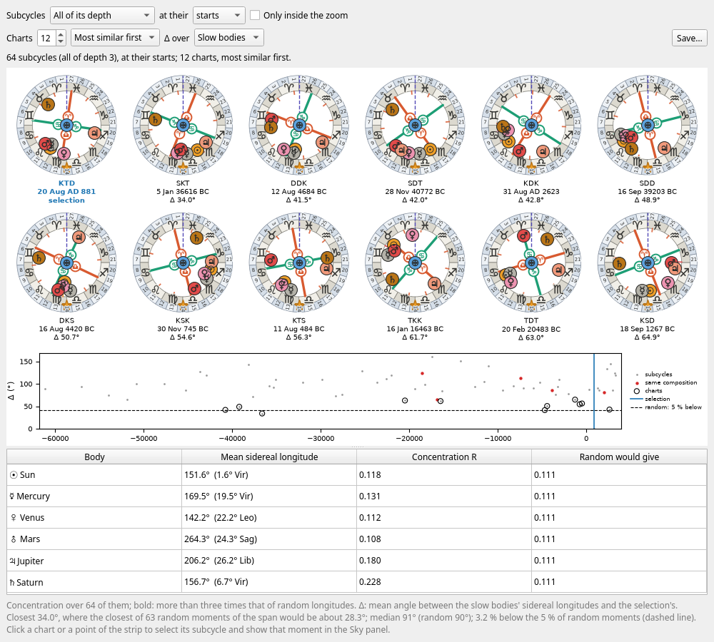

Pone el cielo de la selección junto al de otros subciclos, en sus inicios (o centros, o finales):

- **Conjunto:** todos los de su profundidad, los de su composición, su duración o su órbita ⟨σ⟩, o las partes
  de la selección; dentro del zoom o en todo el ciclo.
- **Gráficos:** un número de cartas pequeñas, repartidas en el tiempo o, con *Most similar first*, la de la
  selección seguida de las más parecidas. Filas y columnas se eligen para que las cartas sean lo más grandes
  posible en el tamaño del panel (o de la página al guardar).
- **Distancia Δ** entre dos cielos: la media del ángulo entre las longitudes sidéreas de los cuerpos comparados,
  por defecto los **lentos** (de Marte en adelante; a escalas de años, el Sol, Mercurio y Venus dependen de la
  época del año más que del ciclo), o todos. Cielos sin relación distan 90° de media.
- **Franja:** la Δ de todos los subciclos del conjunto a lo largo del tramo, con las cartas rodeadas y (para
  todos los de una profundidad) los que resalta el navegador en rojo. La línea discontinua es la distancia por
  debajo de la cual cae el 5 % de los instantes al azar del tramo.
- **Nota:** compara la Δ más cercana y la mediana con lo que darían otros tantos instantes al azar. Si los
  subciclos no se acercan más que el azar, el parecido viene de los periodos de los planetas (Júpiter y Saturno
  se encuentran cada unos 20 años y vuelven cada unos 60), no de la división.
- **Tabla:** para cada cuerpo, la media de sus longitudes sidéreas en el conjunto y su **concentración R** (la
  longitud del vector unitario medio: 1 si coinciden todas, unos √(π/4n) para *n* al azar); en negrita cuando
  supera tres veces ese valor.

Pulsar una carta o un punto de la franja selecciona ese subciclo (que pasa a ser la referencia) y lleva allí el
momento del cielo. Las posiciones de todos los subciclos se calculan de una vez (un nivel de 65 536 en menos de
un segundo; por encima de 100 000 se muestrea), y el panel solo dibuja mientras está a la vista.

## 12.6 *Measures*

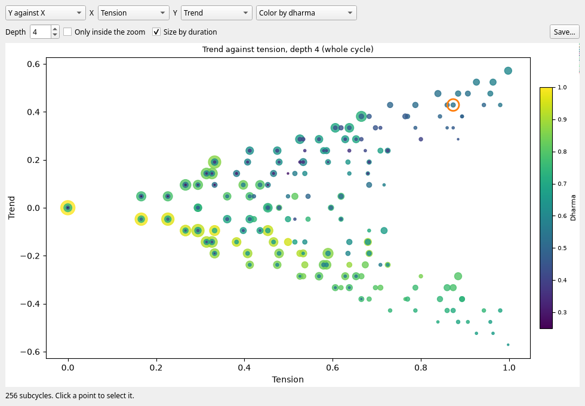

Dos medidas cualesquiera (capítulo 2: dharma, pureza, mezcla, tensión, tendencia, aspereza, contraste, balance y
densidad angular; por defecto, dharma y pureza) del nivel de la selección o de una profundidad elegida (*auto*
sigue a la selección), dentro del zoom o en todo el ciclo:

- *Y against X*: una frente a otra;
- *Y against time* o *Y against index*: la medida Y en orden temporal;
- *X, Y and time (3D)* o *X, Y and index (3D)*: con una línea tenue en orden temporal, vistas predefinidas a lo
  largo de cada eje y arrastre para girar.

Los puntos llevan los colores de los subciclos o, con *Color by…*, el valor de una medida, con su barra de color:
mapa divergente centrado en 0 para las medidas con signo (y en 1 para la densidad angular), secuencial para las
demás, sobre el rango fijo de la medida, de modo que los colores se comparan entre profundidades. La densidad
angular necesita un modelo de ciclo; sin él, el panel lo avisa. Los puntos pueden tener tamaño según la
duración. La selección se rodea en azul, los resaltados en negro; pulsar un punto lo selecciona, y al pasar por
encima se ven sus valores. En la figura se ve que una tendencia fuerte exige tensión y que los subciclos buenos
tienden a descender y los malos a ascender.

Con *Join* (activo por defecto), los subciclos resaltados se **unen**:

- con el resaltado *⟨σ⟩ orbit*, los pasos de la órbita de la selección en orden (la selección, su imagen por σ,
  la de σ², … y vuelta), con flechas púrpura apenas curvadas, para que se distingan un paso y su vuelta;
- con *Same composition*, las ordenaciones de sus edades que difieren en el **intercambio de dos dígitos
  vecinos**, con líneas grises finas (más tenues cuantas más hay).

Así se ve qué hace σ con las medidas, y por qué el orden de los dígitos cambia las medidas pero no la duración:
los intercambios de los niveles exteriores son las líneas largas, y los de una misma posición, paralelas
(capítulo 3). Las uniones solo se dibujan cuando la profundidad del gráfico es la de la selección y, para la
órbita, cuando σ actúa en ella.

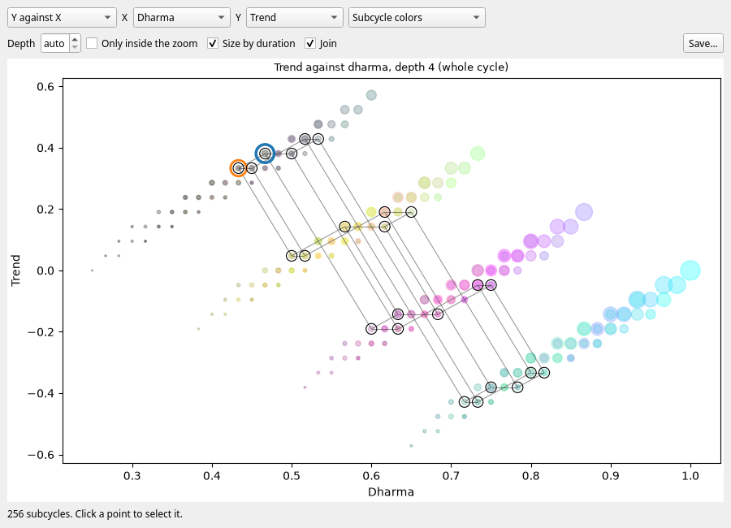

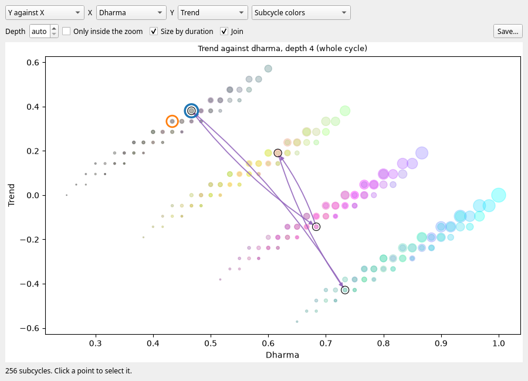

## 12.7 *Color space*

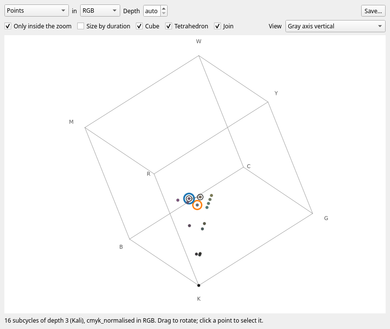

Los colores de un nivel como puntos en 3D, el camino que los une en orden temporal, o ambos: en el cubo RGB (con
sus esquinas nombradas) o, para los coloreados CMYK, en coordenadas de tinta CMY. Sigue al coloreado y a sus
parámetros, dibuja el tetraedro del coloreado `tetrahedron`, puede dar tamaño por duración y tiene vistas
predefinidas (eje de grises vertical, a lo largo de él, las caras del cubo). Rodea la selección y los resaltados
y, con *Join*, los une como el panel *Measures* (en 3D, la dirección de cada paso de la órbita la marca un punto
cerca de su final); pulsar un punto lo selecciona.

## 12.8 *Permutations* y el explorador de grupo

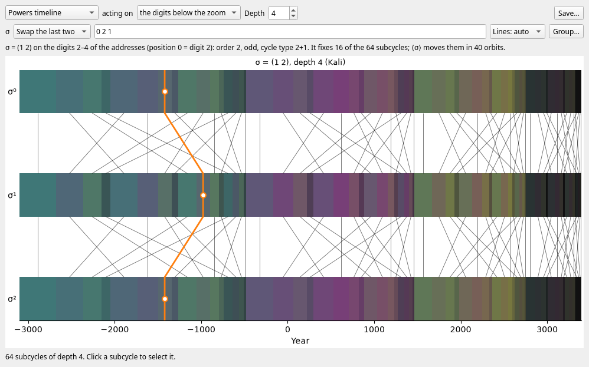

Cómo mueve una permutación σ de las posiciones de los dígitos los subciclos de un nivel (capítulo 3). σ es un
ajuste predefinido o se escribe en notación de una línea (`1 2 0`) o de ciclos (`(0 1 2)(3 4)`); el panel da su
orden, paridad y tipo, cuántos subciclos fija y en cuántas órbitas los mueve ⟨σ⟩. Actúa sobre los dígitos
**bajo el zoom** o sobre **todos**, a una profundidad elegida o automática (la de la selección, o el nivel bajo
el zoom). Vistas:

- **Powers timeline:** las líneas de tiempo de σ⁰, σ¹, … hasta la identidad, con líneas que siguen a cada
  subciclo (automáticas hasta 1024 subciclos);
- **Matrix of σ** y **Matrices of the powers**.

La selección (azul) y, con *Follow*, el momento del cielo (naranja) se siguen a través de las potencias; pulsar
un subciclo lo selecciona. La σ del panel se publica para el resto del explorador (resaltado de órbitas, imagen
en el inspector), aunque el panel esté oculto.

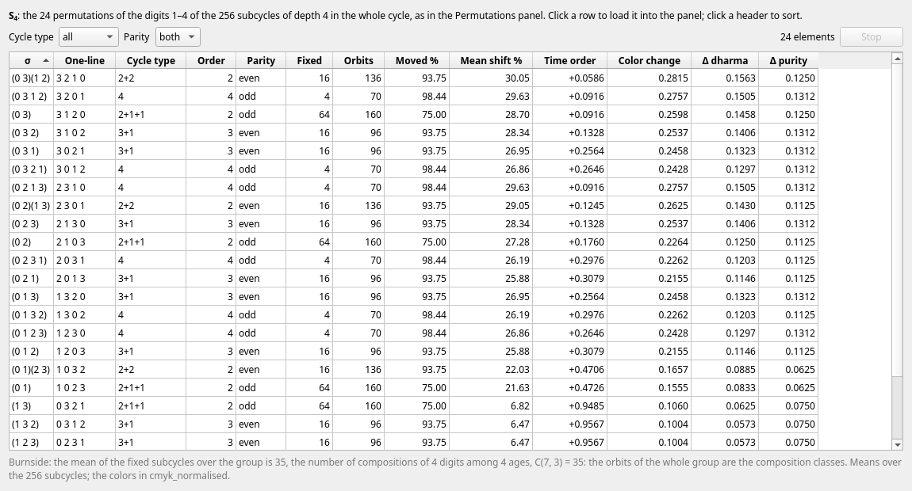

*Group…* abre el **explorador de grupo**: todos los elementos de S_m donde actúa σ, en una tabla que se ordena por
cualquier columna y se filtra por tipo y paridad. Además de la estructura, da medias sobre los subciclos: qué
porcentaje mueve σ, cuánto en el tiempo (% del tramo), cómo conserva el orden temporal (correlación entre el
orden de los subciclos y el de sus imágenes) y cuánto cambia el color, el dharma y la pureza. Las columnas se
llenan poco a poco (S₈ a profundidad 8 tarda en torno a minuto y medio; *Stop* lo interrumpe). Una línea
comprueba el lema de Burnside: la media de los fijos es el número de composiciones. Pulsar una fila carga ese
elemento en el panel.

## 12.9 *Compositions*

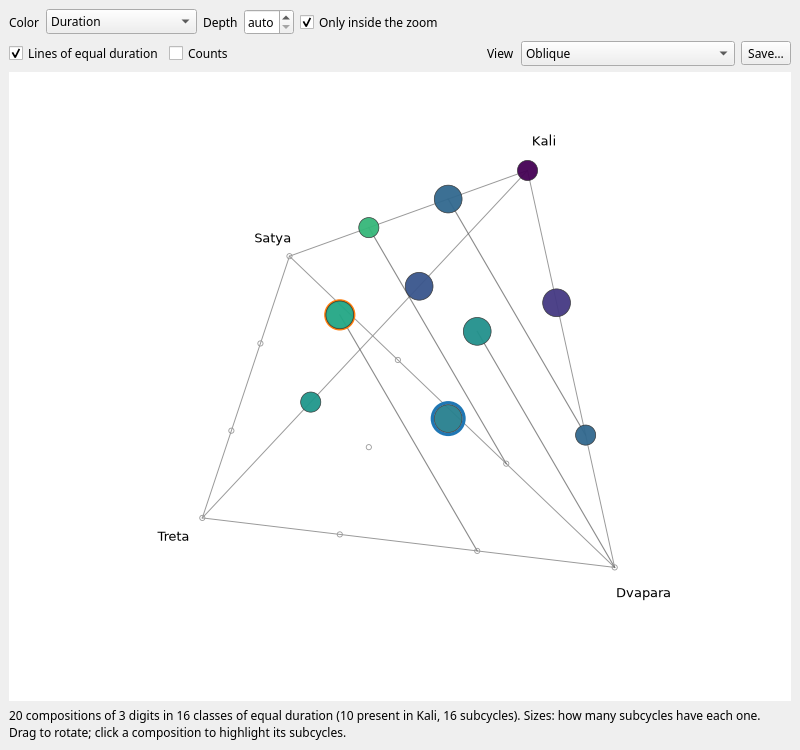

Las composiciones (n₀, n₁, n₂, n₃) de un nivel como puntos de un tetraedro discreto con un vértice por edad (cada
composición en la media de los vértices de sus dígitos), con tamaño según cuántos subciclos la tienen (en el zoom
o en todo el ciclo) y color según la duración, el coloreado `cmyk_composition` o ese número. Las de igual duración
están en rectas paralelas a (1, 0, −2, 1), dibujadas; la vista *Along the lines of equal duration* convierte cada
clase en un solo punto. La composición de la selección se rodea en azul y su clase se dibuja en negro; la del
momento, en naranja. Pulsar una composición selecciona su primer subciclo y resalta todos (*Same composition*).

## 12.10 *Model landscape*

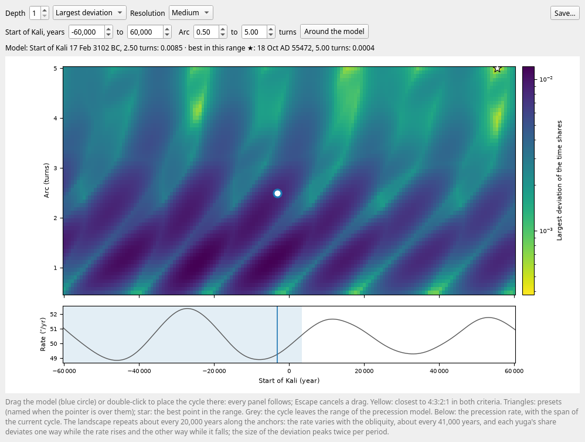

El desajuste de los dos criterios para cada ancla (año del punto de anclaje del modelo) y cada arco en vueltas
(capítulo 8): la mayor desviación o la cuadrática media de las cuotas de tiempo, a profundidad 1 a 3, en escala
logarítmica (amarillo: mejor acuerdo; gris: el ciclo sale del rango del modelo de precesión). Se llena por
filas desde el arco del modelo, sin bloquear la ventana.

- El modelo actual es el **círculo azul**: arrastrarlo, o hacer doble clic en cualquier punto, coloca allí el
  ciclo y todo el explorador lo sigue (Escape cancela; el modelo conserva su nombre y aparece como modificado).
- Los presets con el mismo punto de anclaje son triángulos (se nombran al pasar el puntero) y el mejor punto del
  rango, una estrella.
- Debajo, la tasa de precesión en los mismos años, con el ciclo actual sombreado.
- Controles: profundidad, medida, rangos de ancla y arco, *Around the model*, resolución, *Save…*.
- Con tasa constante no hay paisaje: los criterios coinciden siempre.

## 12.11 *Notes* y los marcadores

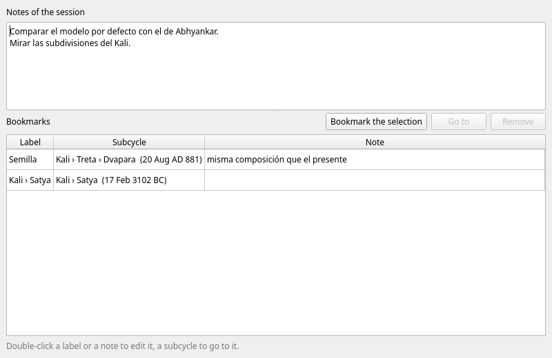

Las **notas de la sesión** (texto libre) y sus **marcadores**: subciclos con una etiqueta y una nota. *View →
Bookmark the selection* (`Ctrl+B`) o el botón del panel añaden la selección y abren su etiqueta para escribirla;
doble clic en una etiqueta o una nota para editarla, en un subciclo para ir a él. Los subciclos marcados tienen
una esquina verde en el navegador, una marca en la franja del ciclo y su etiqueta y nota en la descripción
emergente.

## 12.12 *Events*

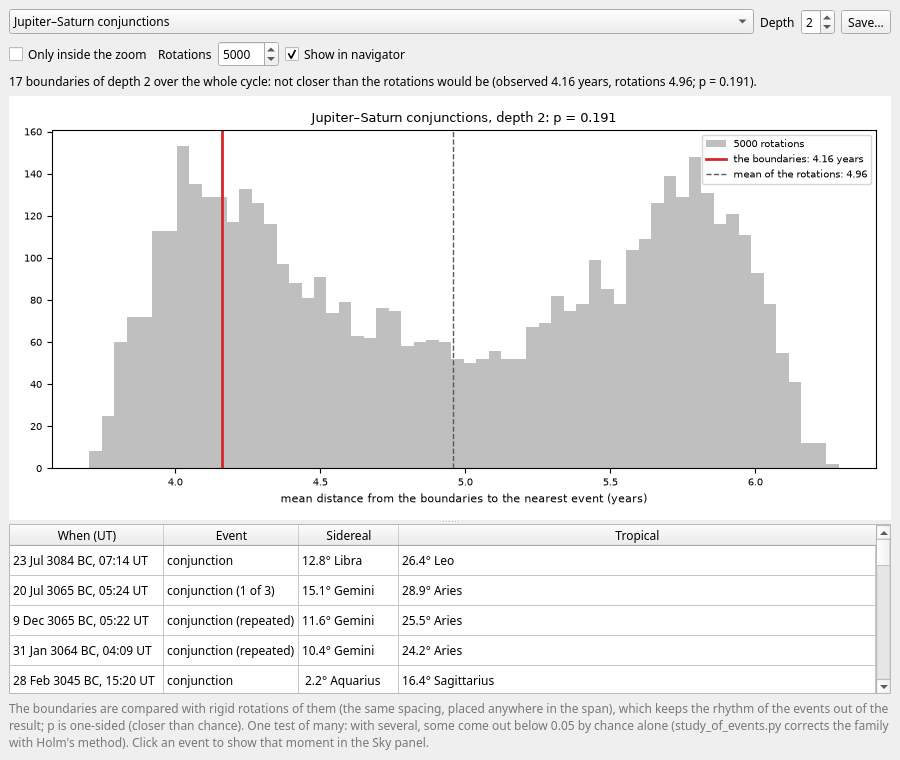

Acontecimientos planetarios frente a las fronteras de los subciclos, con un contraste de significación (capítulo 15).
Se elige la prueba:

- conjunciones de Júpiter y Saturno, de Urano y Neptuno o de Neptuno y Plutón;
- cambios de trígono de las grandes conjunciones, en el zodiaco sidéreo o en el trópico;
- los planetas del Sol a Saturno en 0° de Aries, sidéreo (la afirmación del Sūrya Siddhānta) o trópico (el punto
  vernal), verdaderos o medios (capítulo 15.5).

Y la **vista**: *This model* (las fronteras del modelo actual frente a rotaciones de ellas) u *Over the models*
(el mapa de todos los modelos, ancla × arco, con el p global que tiene en cuenta la búsqueda; capítulo 15.9: un
doble clic en el mapa, o en una fila de la lista de los mejores, coloca allí el ciclo). También la profundidad de
las fronteras (1 a 6), si se prueban en todo el ciclo o solo dentro del zoom, y el
número de rotaciones. El gráfico muestra la distribución del estadístico para las rotaciones rígidas de las
fronteras (gris), su media (discontinua) y el valor de las fronteras (rojo), con el valor p; el encabezado lo
resume. La tabla lista los acontecimientos del tramo ampliado con su fecha (UT) y su posición en ambos zodiacos
(como mucho 2000; con más, se indica que conviene ampliar); para la prueba de 0° de Aries, las fronteras con el
ángulo medio de los planetas y el arco que los contiene. Pulsar una fila lleva allí el momento del cielo y
selecciona el subciclo de esa profundidad que lo contiene.

Con *Show in navigator*, los acontecimientos aparecen en el navegador como marcas rosas justo encima de la primera
fila (translúcidas cuando son tantas que forman una banda), con su nombre y su número en un extremo de la banda de
etiquetas. Los catálogos se calculan una vez con la efeméride del panel *Sky* y se guardan en disco
(`sandbox/data/events/`), compartidos con `study_of_events.py`; el resultado es una sola prueba, y el estudio
corrige la familia completa.

## 12.13 El modelo de ciclo

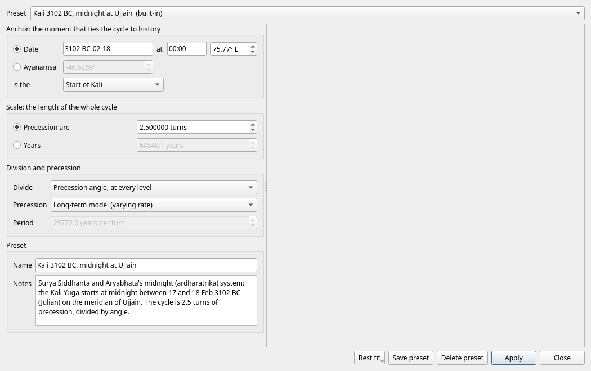

*Model…* abre el editor: ancla (fecha, hora y longitud, o ayanāṃśa, y qué punto del ciclo cae en ella), escala
(arco o años), división, precesión (y periodo, si es constante), nombre y notas. A la derecha se ven al momento
los inicios de los yugas (UT), sus años, cuotas de tiempo y de arco, vueltas, ayanāṃśa y tasa media, y la mayor
desviación de las cuotas. *Apply* lo aplica; *Save preset* y *Delete preset* gestionan los presets del usuario;
*Best fit* busca el ancla y/o el arco que mejor cumplen ambos criterios (capítulo 8) y carga el resultado.

## 12.14 Los parámetros de color

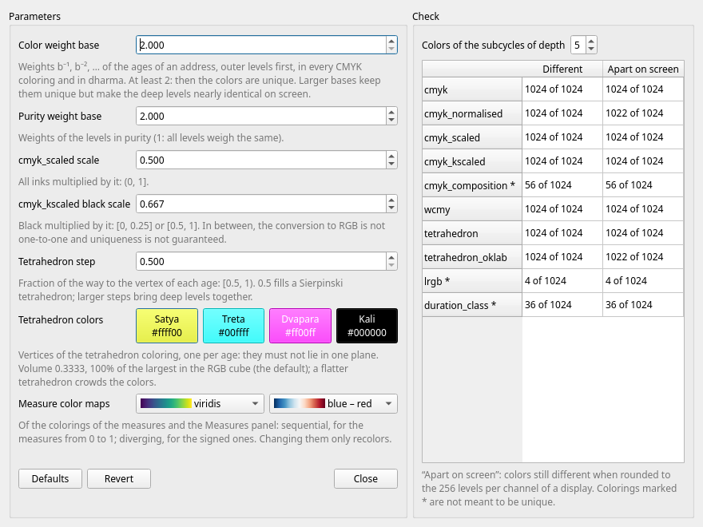

*Parameters…* ajusta las bases y escalas de los coloreados y las medidas, y los cuatro colores del tetraedro,
dentro de los rangos que mantienen distintos los colores de cada nivel (capítulo 2): los valores fuera de rango
no se aplican y se explica por qué. A la derecha, para una profundidad, cuántos colores son distintos y cuántos
se distinguen en una pantalla (redondeados a 256 niveles por canal), para los diez coloreados de la dirección (los de
medidas y del modelo no buscan colores únicos). *Measure color maps* elige los dos mapas de color de las medidas,
cada uno con su degradado: el secuencial (de 0 a 1: dharma, pureza, mezcla, tensión, aspereza) y el divergente
(con signo: tendencia, contraste, balance, y la densidad angular centrada en 1). Valen para los coloreados y para
*Color by…* del panel *Measures*, y cambiarlos solo recolorea. Los cambios se aplican al momento;
*Revert* vuelve a los valores con que se abrió y *Defaults* a los de por defecto.

## 12.15 Guardar gráficos

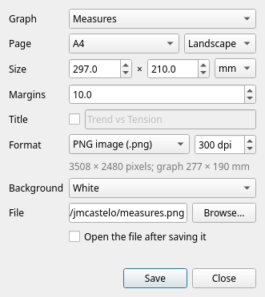

*File → Save graph…* (`Ctrl+E`), o el botón *Save…* de los paneles de gráficos, guarda el navegador o un panel tal
como se ve (ángulos de vista, selección y momento incluidos): en un formato de papel (A5 a A1, Letter, Legal,
Tabloid; vertical o apaisado), al tamaño de la pantalla o a medida (mm, cm, pulgadas), con márgenes y título
opcional; en PNG o JPEG a una resolución elegida, o en PDF, SVG o EPS (vectoriales; EPS solo para los paneles),
con fondo blanco o transparente. El navegador se dibuja para la página con una paleta clara.

## 12.16 Sesiones

Una **sesión** es todo lo que muestra el explorador, guardado en un fichero JSON (`*.cycles.json`; el proyecto los
guarda en `sandbox/sessions/`, fuera del control de versiones):

- el modelo de ciclo **completo** (no solo el nombre de su preset, que podría cambiar después) y el nombre del
  preset si coincide;
- los parámetros de color y las opciones de presentación, el zoom, la selección, la fecha marcada, el momento del
  cielo;
- los ajustes de cada panel (con la cámara de las vistas 3D en modo libre; una σ al azar se guarda como la que se
  mostraba);
- la disposición de la ventana y sus esquinas;
- las notas y los marcadores;
- la versión del programa, su commit de git (y si tenía cambios sin confirmar) y la carpeta de la efeméride.

| Menú *File* | Atajo |
|---|---|
| *New session* (mantiene la disposición) | `Ctrl+N` |
| *Open session…* | `Ctrl+O` |
| *Open recent* (las ocho últimas) | |
| *Save session* | `Ctrl+S` |
| *Save session as…* | `Ctrl+Mayús+S` |

El título de la ventana lleva el nombre de la sesión, un `*` mientras hay cambios sin guardar y la versión del programa. **El explorador
reabre la última sesión al arrancar**: se guarda sola al cerrar la ventana (y cada minuto si hay cambios), con su
fichero y sus cambios pendientes, así que no se pregunta nada al salir. Si la carpeta de la efeméride de una sesión
no existe en este equipo se conserva la actual, y las partes que ya no encajan se avisan en la barra de estado.
Un fichero que no es una sesión, o de una versión posterior, se rechaza sin cambiar nada.

## 12.17 El dosier de un subciclo

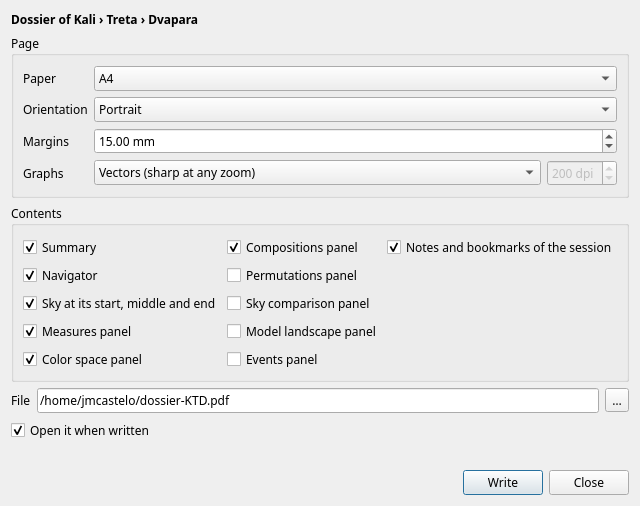

*File → Subcycle dossier…* (`Ctrl+D`) escribe un PDF sobre el subciclo seleccionado, en el papel elegido (A5 a A1,
Letter, Legal, Tabloid; vertical o apaisado) con márgenes a elegir. Secciones (cada una opcional):

1. **Resumen**: todo lo del inspector, las medidas por nivel, sus colores, sus marcadores, y el modelo, la sesión y
   el código de que procede;
2. **Navegador** alrededor del subciclo (con el zoom en su padre, sin mover el del explorador);
3. **Cielo** en su inicio, centro y final (con efeméride);
4. los gráficos de **Measures, Color space, Compositions, Permutations, Sky comparison, Model landscape y Events** tal
   como están configurados, recompuestos para la página;
5. **Notas y marcadores** de la sesión.

El pie de cada página lleva el subciclo, la sesión, la fecha y la versión del programa. Texto y navegador son vectoriales; los gráficos también, o imágenes a una resolución elegida (más ligeras con
muchos puntos). Las opciones se recuerdan; *Open it when written* lo abre al terminar. Con todo, en A4 son unas
11 páginas, en unos 2 s.

## 12.18 Disposición de los paneles

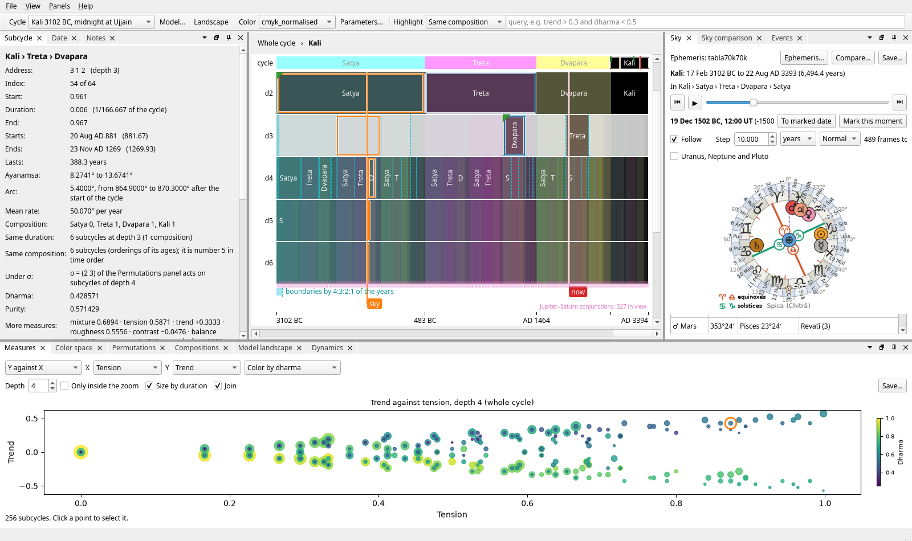

Los once paneles pueden estar abiertos a la vez. El menú *Panels*:

- muestra u oculta cada uno (`Alt+1` a `Alt+9` y `Alt+0`; el undécimo, *Events*, sin atajo);
- los ordena en pestañas (`Ctrl+Alt+T`), lado a lado (`Ctrl+Alt+S`), apilados (`Ctrl+Alt+V`), en rejilla 2 × 2
  (`Ctrl+Alt+G`) o lado a lado bajo el navegador (`Ctrl+Alt+B`);
- **Arrange around the navigator**: cada tipo de panel en su lado, en pestañas (información = Subcycle, Date,
  Notes; cielo = Sky, Sky comparison, Events; gráficos = el resto): *Left and right* (`Ctrl+Alt+L`), *Around the
  navigator* (`Ctrl+Alt+A`, información a la izquierda, cielo a la derecha, gráficos debajo), *Left and below*
  (`Ctrl+Alt+D`). Los paneles cerrados siguen cerrados, pero colocados en su lado;
- **Move a panel** (también con clic derecho en la barra de título o en la pestaña de un panel): a la izquierda, la
  derecha, encima o debajo del navegador (junto a los que ya haya allí), flotante o en una pestaña con otro;
- **Corners**: si las columnas laterales ocupan toda la altura de la ventana o las filas de arriba y abajo toda la
  anchura;
- **Layouts**: disposiciones con nombre (*Save layout as…*), para cambiar entre ellas en cualquier sesión;
- **Reset layout**: vuelve a las pestañas.

Los paneles también se pueden arrastrar (un grupo de pestañas, entero, por su barra de título). El navegador
conserva siempre un mínimo de espacio. La disposición se guarda con la sesión y entre ejecuciones.

## 12.19 El lanzador de estudios

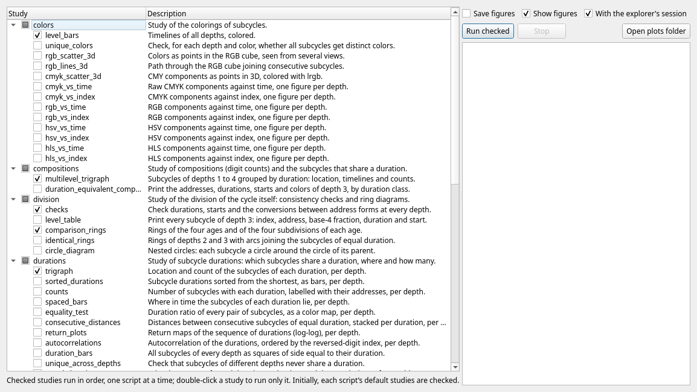

*File → Studies…* (`Ctrl+T`) muestra todos los estudios del sandbox (capítulo 11), con los de por defecto
marcados. Ejecuta los marcados (o uno con doble clic) como en la línea de órdenes, cada guion en su proceso, con
*Save figures* (`--save`), *Show figures* (sin `--no-show`) y *With the explorer's session* (`--session` con el
modelo y los colores que se ven), y muestra su salida. *Open plots folder* abre `sandbox/plots/`.

## 12.20 Atajos de teclado

| Atajo | Acción |
|---|---|
| `Ctrl+N` / `Ctrl+O` / `Ctrl+S` / `Ctrl+Mayús+S` | nueva, abrir, guardar, guardar como (sesión) |
| `Ctrl+E` | guardar gráfico |
| `Ctrl+D` | dosier del subciclo |
| `Ctrl+T` | estudios |
| `Ctrl+B` | marcar la selección |
| `Ctrl+↑` / `Ctrl+Inicio` | reducir el zoom / todo el ciclo |
| `Alt+1` … `Alt+9`, `Alt+0` | mostrar u ocultar cada panel |
| `Ctrl+Alt+T/S/V/G/B` | disposiciones: pestañas, lado a lado, apilados, rejilla, debajo |
| `Ctrl+Alt+L/A/D` | alrededor del navegador: izquierda y derecha, alrededor, izquierda y debajo |
| `Ctrl+Q` | salir |

*Help → Navigation* resume los controles del navegador; *Help → About* da la versión del programa y su commit de git (capítulo 10, «Versiones»).
