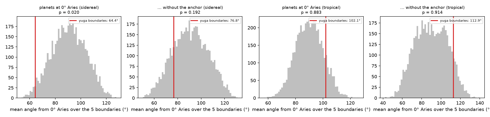
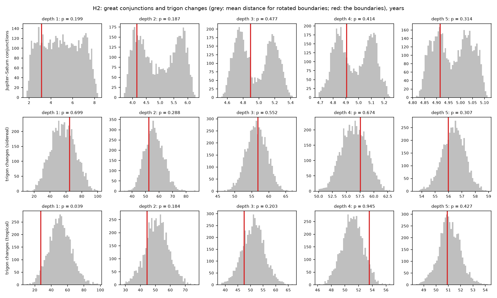
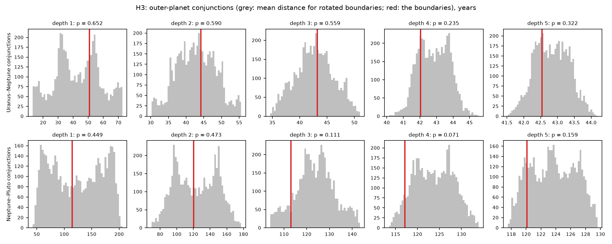
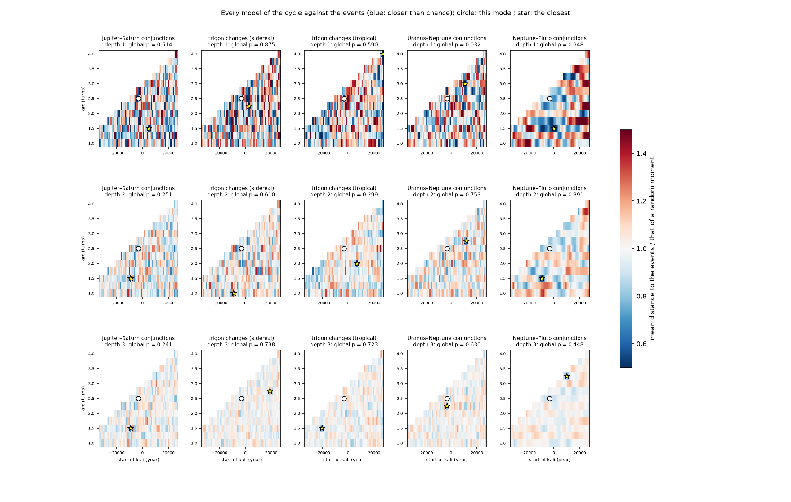

# 15. Eventos planetarios y significación

*Nuevo en la versión 0.3.0: cálculo, estudio y el panel* Events *del explorador.*

## 15.1 La pregunta

¿Caen las fronteras de los subciclos sobre acontecimientos planetarios **más de lo que lo haría el azar**? Mirar
cartas del cielo una a una no lo puede decidir: siempre aparece alguna configuración llamativa (capítulo 9). Lo
que sí se puede hacer es calcular los **catálogos completos** de ciertos acontecimientos a lo largo de todo el ciclo y
comparar las fronteras con un **modelo nulo**.

La astrología entra aquí como **fuente de hipótesis precisas**: aporta las definiciones (conjunciones, signos,
elementos, el punto de Aries), y el contraste dice si las fronteras coinciden con ellas más que el azar. Se
calculan las dos tradiciones: la **sidérea** (Lahiri, la del Jyotiṣa y la de todo el proyecto) y la **trópica**
(la occidental, desde el equinoccio de la fecha).

## 15.2 Los catálogos de acontecimientos

`cycles.functions.events` calcula, con la efeméride (capítulo 6):

- **Conjunciones exactas** de dos cuerpos (`conjunctions`, o cualquier aspecto con `aspect_times`): la separación
  angular se muestrea cada 10 días y cada cambio de signo se afina por bisección, todos a la vez, hasta unos
  segundos. Una conjunción repetida por el movimiento retrógrado (dentro de 2 años) forma una **serie**.
- El **signo y el elemento** de cada conjunción en ambos zodiacos. Las conjunciones ocurren en el mismo instante en
  los dos (el ayanāṃśa se anula en una diferencia de longitudes); solo cambian el signo y el elemento.
- Los **cambios de trígono** (de elemento) de las grandes conjunciones de Júpiter y Saturno (`trigon_changes`),
  contados como la tradición: cuando las conjunciones **se asientan** en el nuevo elemento. Cerca de un cambio
  alternan un tiempo (1981 aire, 2000 tierra, 2020 aire); las rachas de menos de dos series se consideran de paso.
  Así, en el zodiaco trópico hay un cambio cada **200 años** de media (fuego en 1603, la conjunción de Kepler;
  aire en 2020), y en el sidéreo cada 221.
- Cómo están unos cuerpos alrededor de un punto (`around_point`): el ángulo medio desde él y el arco mínimo que
  los contiene a todos.

Comprobaciones con fechas conocidas (pruebas `tests/test_events.py`): la conjunción triple de Júpiter y Saturno de
1980–81 en Libra (31 dic, 4 mar, 24 jul), la del 28 de mayo de 2000 en Tauro (22°43′) y la del 21 de diciembre de
2020 a 0°30′ de Acuario; Urano y Neptuno en 1993 (2 feb, 20 ago, 24 oct, 19° de Capricornio); Neptuno y Plutón en
1891–92 (8° de Géminis).

| Catálogo (modelo por defecto, con 200 años de margen) | Conjunciones | Series | Una serie cada |
|---|---:|---:|---:|
| Júpiter–Saturno | 4 260 | 3 270 | 19,9 años |
| Urano–Neptuno | 915 | 379 | 171 años |
| Neptuno–Plutón | 307 | 131 | 494 años |

Calcular los tres lleva unos 30 s; `study_of_events.py` los guarda en `sandbox/data/events/`.

## 15.3 El contraste: rotaciones rígidas

`cycles.functions.significance`:

- **Estadístico.** Para los acontecimientos, la **distancia media** (en años) de cada frontera al acontecimiento más
  cercano (`proximity_test`); para una configuración, la media de una medida del cielo en las fronteras
  (`value_test`). Menor = más llamativo.
- **Modelo nulo: rotación rígida.** Todas las fronteras se desplazan **la misma cantidad** al azar, dando la vuelta
  al ciclo: se conserva su espaciado y solo cambia su colocación. Es la comparación adecuada para acontecimientos
  **periódicos**: con instantes al azar, el ritmo propio de las conjunciones (cada 20 años) se confundiría con una
  coincidencia con la división. En los histogramas de la figura 15.2 se ve: para Júpiter y Saturno, la
  distribución nula es bimodal a partir de la profundidad 2, por la interacción del periodo de las conjunciones
  con el espaciado de las fronteras.
- **Valor p** unilateral, con $N = 5000$ rotaciones y $S_r$ el estadístico de cada una:
  $p = \left(1 + \#\{r : S_r \le S_{\text{obs}}\}\right) / (1 + N)$.
- **Corrección de Holm** sobre toda la familia de pruebas: con muchas pruebas, alguna sale «significativa» por azar
  (con 29 pruebas se esperan unas 1,5 con p < 0,05).

Las fronteras son las de profundidad 1 a 5 del modelo (de 5 a 1025), convertidas de UT a TDB como en el explorador.

Como referencia, la distancia media de un instante al azar al acontecimiento más cercano se calcula exactamente a
partir de los huecos $g_i$ entre acontecimientos consecutivos de un tramo de longitud $L$ (`expected_distance`; los
extremos $h$ y $h'$, del inicio al primero y del último al final):

$$
\bar d = \frac{1}{L}\left(\sum_i \frac{g_i^2}{4} + \frac{h^2 + h'^2}{2}\right)
$$

## 15.4 H1: el Sūrya Siddhānta, los planetas en 0° de Aries

El Sūrya Siddhānta sitúa todos los planetas (medios) juntos al comienzo de Aries al inicio del Kali y del Mahāyuga.
Se mide en los planetas **verdaderos** del Sol a Saturno (sin la Luna): su ángulo medio desde 0° de Aries (90° de
media para longitudes al azar) y el arco que los contiene.

| Frontera | Sidéreo: ángulo medio (azar ≤) | Trópico: ángulo medio (azar ≤) | Arco (azar ≤) |
|---|---|---|---|
| inicio del Satya | 114,2° (72 %) | 101,1° (61 %) | 110,5° (16 %) |
| inicio del Treta | 42,7° (7 %) | 109,8° (69 %) | 140,3° (30 %) |
| inicio del Dvapara | 39,7° (5 %) | 104,3° (64 %) | 107,3° (15 %) |
| **inicio del Kali** | **15,0° (0,0 %)** | 58,9° (21 %) | **41,0° (0,4 %)** |
| fin | 110,4° (68 %) | 136,5° (92 %) | 179,6° (54 %) |

Contraste de las cinco fronteras: **sidéreo p = 0,020**, trópico p = 0,88. Pero el inicio del Kali es el **ancla**
del modelo, la fecha tradicional, que pudo elegirse precisamente por su reunión de planetas (la época del Sūrya
Siddhānta se calculó hacia atrás a partir de las posiciones medias): un resultado que descansa en ella es
**circular**. Sin el ancla: sidéreo **p = 0,19**, trópico p = 0,91. Las demás fronteras de los yugas no comparten
esa configuración.



## 15.5 H2: las grandes conjunciones y sus cambios de trígono

La doctrina persa de las edades del mundo (Māshāʾallāh, Abū Maʿshar) dividía la historia con las conjunciones de
Júpiter y Saturno y sus cambios de trígono. ¿Caen las fronteras cerca de ellas?

| Prueba | Prof. 1 | 2 | 3 | 4 | 5 |
|---|---|---|---|---|---|
| Conjunciones Júpiter–Saturno (años: observado / rotaciones; p) | 3,2 / 5,0; 0,20 | 4,2 / 5,0; 0,19 | 4,9 / 5,0; 0,48 | 4,9 / 5,0; 0,41 | 4,9 / 5,0; 0,31 |
| Cambios de trígono, sidéreo | 64,8 / 56,4; 0,70 | 52,4 / 56,3; 0,29 | 56,8 / 56,4; 0,55 | 57,5 / 56,4; 0,67 | 56,0 / 56,4; 0,31 |
| Cambios de trígono, trópico | 27,4 / 51,0; **0,039** | 44,5 / 51,1; 0,18 | 47,5 / 51,2; 0,20 | 53,6 / 51,1; 0,95 | 50,9 / 51,1; 0,43 |



## 15.6 H3: las conjunciones de los planetas exteriores

| Prueba | Prof. 1 | 2 | 3 | 4 | 5 |
|---|---|---|---|---|---|
| Urano–Neptuno (años; p) | 50,8 / 42,8; 0,65 | 44,2 / 42,8; 0,59 | 43,2 / 42,7; 0,56 | 42,1 / 42,8; 0,24 | 42,5 / 42,8; 0,32 |
| Neptuno–Plutón (años; p) | 114,7 / 123,7; 0,45 | 120,1 / 123,1; 0,47 | 113,1 / 123,7; 0,11 | 117,1 / 123,7; 0,071 | 120,1 / 123,6; 0,16 |



## 15.7 Resultado

Con el modelo por defecto, **ninguna de las 29 pruebas es significativa tras la corrección de Holm**. Los dos
valores p brutos por debajo de 0,05 (H1 sidéreo con el ancla, 0,020; cambios de trígono trópicos a profundidad 1,
0,039) son los que se esperan por azar en una familia de este tamaño, y el primero se explica por la elección del
ancla.

Matices:

- El resultado es **condicional al modelo** (ancla y arco); la sección 15.8 lo extiende a todos los modelos.
- Antes de −3000 la efeméride no tiene referencia independiente; los planetas lentos, los de H2 y H3, son los más
  robustos.
- H1 mide los planetas **verdaderos**; la afirmación del Sūrya Siddhānta es sobre los **medios**.

## 15.8 Todos los modelos a la vez

Los resultados anteriores son de un modelo. ¿Hay **alguna** colocación del ciclo (ancla y arco) cuyas fronteras
caigan sobre los acontecimientos más de lo que permite el azar? Comparar muchos modelos y quedarse con el mejor es
una búsqueda: el mejor parecerá siempre especial. El contraste tiene que tenerlo en cuenta («look-elsewhere»):

1. `boundary_grid` da las fronteras de todos los modelos de una rejilla (ancla $\pm 30\,000$ años alrededor de la
   del modelo, cada 1000; arco de 1 a 4 vueltas, cada 0,25), dividiendo el arco. Los que salen del alcance de la
   efeméride (unos $-68\,000$ a $+72\,000$) se descartan: quedan 474.
2. Para cada modelo, la razón $\rho$ entre la distancia media de sus fronteras al acontecimiento más cercano y la de
   un instante al azar, $\bar d$ ($\rho < 1$: más cerca que el azar).
3. **Valor p global** (`scan_models`): se desplaza rígidamente el catálogo de acontecimientos (con su ritmo) una
   cantidad al azar, $N = 1000$ veces, y cada vez se busca el mejor modelo. El valor p global es la proporción de
   desplazamientos cuyo mejor modelo se acerca tanto como el mejor real:
   $p_{\text{global}} = \left(1 + \#\{k : \min_m S_m^{(k)} \le \min_m S_m\}\right) / (1 + N)$.

Con los cinco catálogos y las profundidades 1 a 3 (15 pruebas), **ninguna es significativa tras Holm**: la menor
es Urano–Neptuno a profundidad 1, $p_{\text{global}} = 0{,}032$ (0,48 corregido). El modelo por defecto no destaca:
según la prueba, entre el 4 % y el 75 % de los modelos se acercan tanto como él.

| Prueba | Prof. | Este modelo: $\rho$; % de modelos tan cerca | Mejor modelo: ancla, arco, $\rho$ | $p_{\text{global}}$ |
|---|---:|---|---|---:|
| Júpiter–Saturno | 1 | 0,63; 8 % | 4899, 1,5; 0,30 | 0,51 |
| Júpiter–Saturno | 2 | 0,84; 14 % | −9101, 1,5; 0,51 | 0,25 |
| Trígono sidéreo | 1 | 1,15; 68 % | 2899, 2,25; 0,34 | 0,88 |
| Trígono trópico | 1 | 0,53; 4 % | 26899, 4; 0,30 | 0,59 |
| Urano–Neptuno | 1 | 1,19; 75 % | 10899, 3; 0,19 | 0,032 |
| Neptuno–Plutón | 1 | 0,87; 32 % | −101, 1,5; 0,43 | 0,95 |
| Neptuno–Plutón | 3 | 0,91; 7 % | 9899, 3,25; 0,82 | 0,45 |

(Selección; `study_of_events.py model_map` da las 15.)



A profundidad 1 el mapa parece ruido: mover el ancla 1000 años desplaza cada frontera un número distinto de veces
el ritmo de los acontecimientos (20 años para Júpiter y Saturno). El contraste global es válido para la rejilla
explorada; una rejilla más fina sería simplemente una búsqueda mayor.

## 15.9 Cómo se ejecuta

```bash
python sandbox/study_of_events.py --list
python sandbox/study_of_events.py event_catalog          # calcular o cargar los catálogos
python sandbox/study_of_events.py surya_siddhanta        # H1
python sandbox/study_of_events.py great_conjunctions     # H2
python sandbox/study_of_events.py outer_conjunctions     # H3
python sandbox/study_of_events.py summary --save         # las 29 pruebas con Holm; guarda summary.csv
python sandbox/study_of_events.py model_map --save       # todos los modelos (ancla × arco) y el p global
python sandbox/study_of_events.py --all --session sandbox/sessions/otro_modelo.cycles.json
```

## 15.10 En el explorador

El panel *Events* (capítulo 12) hace cada una de estas pruebas de forma interactiva: elige el catálogo, la
profundidad, todo el ciclo o solo el zoom y el número de rotaciones; dibuja la distribución nula con el valor
observado, lista los acontecimientos del tramo (y lleva el momento del cielo a cualquiera de ellos) y los marca en
el navegador. Con la vista *Over the models* dibuja el mapa de la sección 15.8 para la prueba y la profundidad
elegidas, con el modelo actual, el mejor y el p global; un doble clic en el mapa, o en una fila de la lista de los
mejores modelos, coloca allí el ciclo. Usa los mismos catálogos guardados que el estudio. Cada resultado del panel es una sola prueba: la
corrección de la familia está en `summary`.

## 15.11 Pendiente

Otras familias de acontecimientos (aspectos, ingresos en signos y nakṣatras, estaciones, reuniones de planetas, el
punto vernal entrando en un signo), el Sol y Júpiter en Puṣya al final del Kali, el modelo nulo de las
permutaciones de dígitos, H1 con los planetas medios del propio Sūrya Siddhānta y los acontecimientos históricos
con fecha (los mismos contrastes con otro catálogo).
