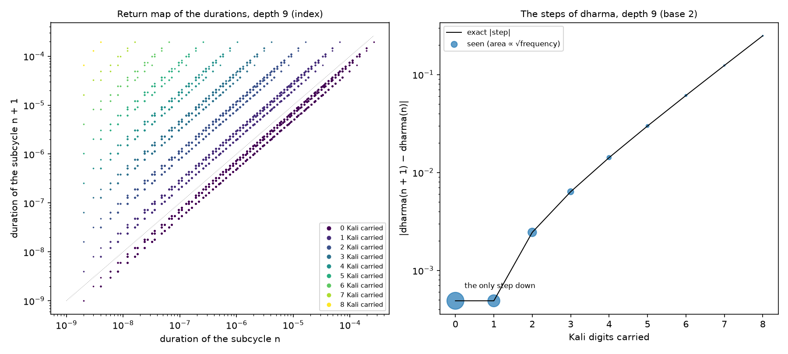
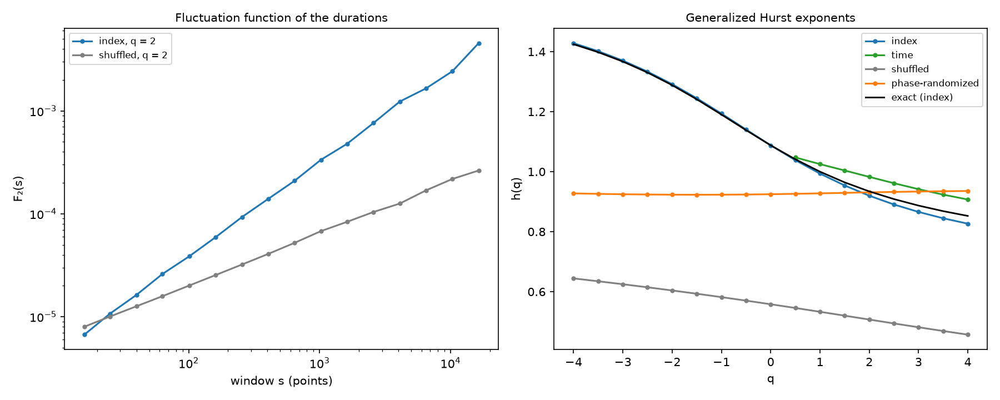
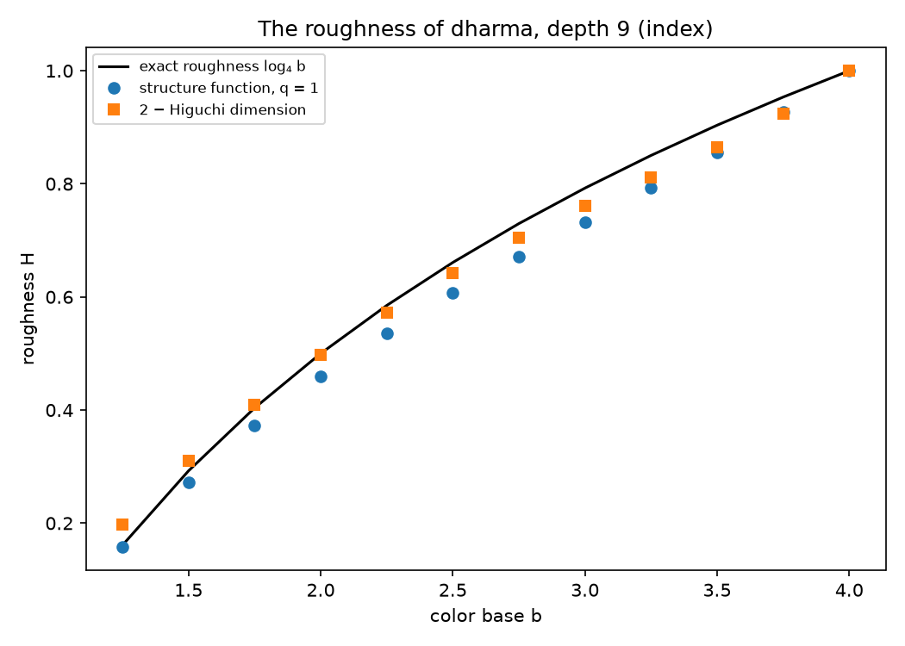
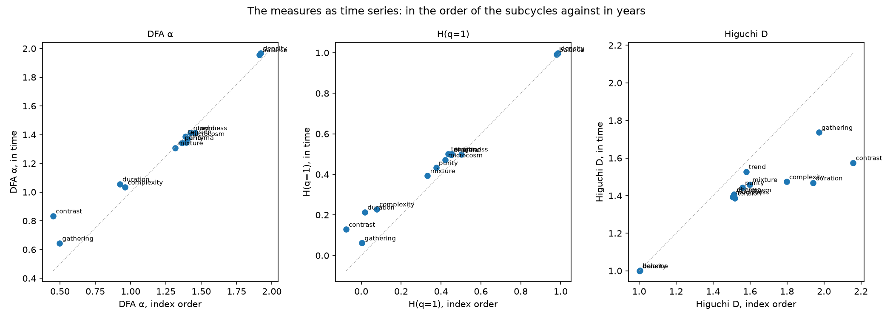
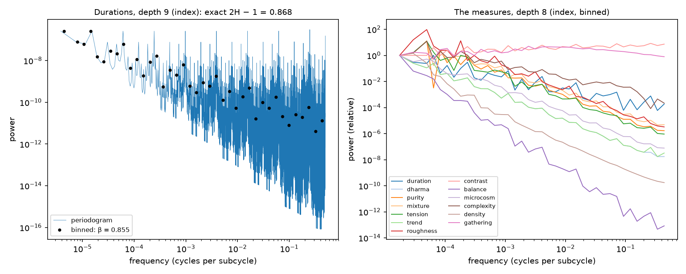
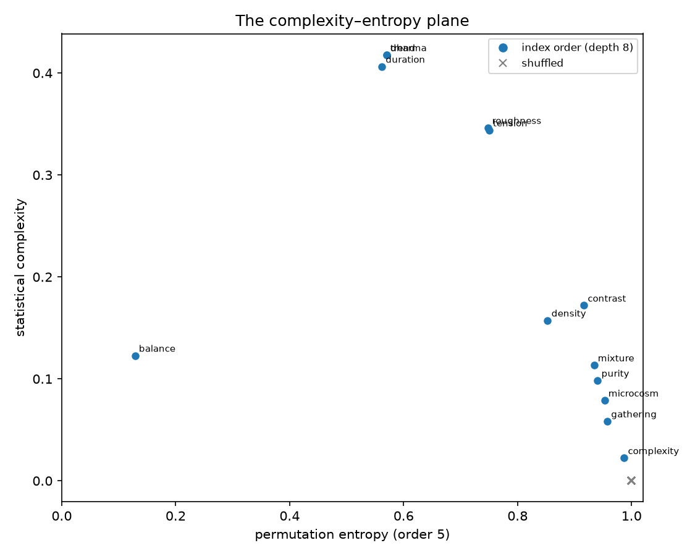
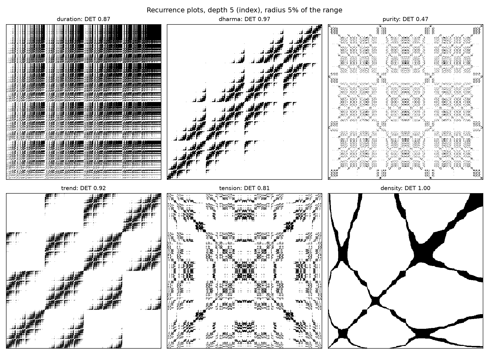

# 16. Dinámica: la evolución en el tiempo

*Nuevo, sin publicar: `cycles.functions.dynamics` y el estudio `study_of_dynamics.py`.*

## 16.1 La pregunta

Las medidas (capítulo 2) y las duraciones describen cada subciclo por separado. Aquí se miran **como series
temporales**: cómo cambian de un subciclo al siguiente, qué memoria tienen, qué rugosidad, qué se repite. Son las
preguntas de los **sistemas dinámicos** y del análisis de series: mapas de retorno, exponentes de Hurst,
dimensiones fractales de las gráficas, espectros, patrones ordinales, recurrencias, tiempos de retorno.

La división tiene una ventaja poco común: para las duraciones y el dharma muchas de estas cantidades se conocen
**exactamente**. Eso permite probar primero los estimadores contra lo exacto y saber cuáles son de fiar aquí, antes
de usarlos con las demás medidas, que no tienen respuesta exacta.

## 16.2 Dos dinámicas

Sobre la división actúan dos dinámicas distintas:

- **A lo largo del tiempo.** El subciclo siguiente a uno de profundidad $d$ es su dirección más uno, en base 4 y con
  acarreos: Kali pasa a Satya y el dígito anterior sube una edad. Es un **odómetro**: determinista, de entropía
  nula, con periodo $4^d$. Toda medida leída así es una suma de patrones que se repiten cada 4, 16, 64…
  subciclos, y su espectro solo tiene picos en las frecuencias $k/4^m$.
- **A través de las escalas.** Ampliar una edad hasta llenar el ciclo es la aplicación
  $T(x) = (x - o_a)/p_a$: cuatro ramas lineales de pendientes $1/p$ (2,5; 3,33; 5 y 10). Conserva el tiempo (la
  medida de Lebesgue) y es **caótica**: su entropía de Kolmogorov–Sinái es igual a su exponente de Lyapunov,
  $$h = \lambda = H(p) = -\sum_a p_a \log p_a = 1{,}2799 \text{ nats por nivel } (1{,}8464 \text{ bits}),$$
  un aumento típico de $e^{H} = 3{,}596$ por nivel. Su entropía topológica es $\log 4$ (cuatro ramas), la de la
  medida de recuento, cuyo exponente de Lyapunov es $-\tfrac14 \sum \log p_a = 1{,}5081$; el cociente de entropía
  y Lyapunov da la dimensión de cada medida: $1{,}2799/\log 4 = 0{,}9232$ y $\log 4/1{,}5081 = 0{,}9192$, las $D_1$
  del espectro multifractal (1.9).

## 16.3 Dos maneras de leer una serie

- **En el orden de los índices**: un valor por subciclo, en orden temporal; todos los subciclos cuentan igual. Es
  la serie del odómetro.
- **En el tiempo**: la serie muestreada en instantes repartidos por igual en **años** del modelo de ciclo
  (`time_samples`, con el mapa de tiempo); cada subciclo cuenta tanto como dura. El modelo por defecto dura
  64 540 años, así que a profundidad 8 un subciclo dura de media un año, y uno todo Satya, 42.

En el tiempo, un subciclo largo repite su valor en muchas muestras seguidas. Esas mesetas no son dinámica, sino
muestreo, y estorban a dos estimadores: los momentos negativos del análisis de fluctuaciones, que miran las
ventanas más tranquilas, y los patrones ordinales, que tratan los empates. Esos se calculan solo en el orden de los
índices.

## 16.4 Lo que se sabe exactamente

**Los mapas de retorno de las duraciones.** La duración siguiente se obtiene de la actual sin calcular nada más:
si el subciclo acaba en $k$ dígitos Kali y el dígito anterior es $j$,
$$\frac{d(n+1)}{d(n)} = \frac{p_{j+1}}{p_j} \cdot 4^k,$$
porque los $k$ Kali (0,1 cada uno) pasan a Satya (0,4). Un paso con $k$ acarreos ocurre en 3 de cada $4^{k+1}$
pasos. En el mapa $d(n+1)$ frente a $d(n)$ los puntos caen sobre rectas paralelas a la diagonal, una familia por
cada $k$: a profundidad 9, 27 razones distintas. El mapa es exacto para los 262 143 pares.

**Los pasos del dharma.** Con base $b$, el dharma de un subciclo al siguiente cambia en
$$\Delta_k = \frac{3 \sum_{i > d-k} w_i - w_{d-k}}{4 \sum w}, \qquad w_i = b^{-i}:$$
el dígito que sube resta su peso y los $k$ Kali que vuelven a Satya suman tres edades cada uno. Solo hay $d$
valores. El paso sin acarreo es el único que baja (−0,000489 a profundidad 9 con base 2), y el de $k = 8$
sube 0,249. Con un acarreo, el dharma sube por debajo de la base 3, no cambia con base 3 y baja por encima: el
dharma **baja despacio y sube de golpe**, que es lo que el contraste (2.4) ya mostraba.

**Los exponentes de Hurst generalizados de las duraciones.** En el orden de los índices, las duraciones son la
cascada multinomial del tiempo (1.9), y su perfil (la suma acumulada) es el tiempo transcurrido. De ahí
$$h(q) = \frac{1 + \tau(q)}{q}, \qquad \tau(q) = -\log_4 \sum_a p_a^q,$$
con $h(2) = H = 0{,}9342$ (memoria larga, persistente), $h(1) = 1$, $h(0) = \alpha_0 = 1{,}0878$ (el exponente
típico del tiempo) y $h$ entre 1,425 en $q = -4$ y 0,853 en $q = 4$: la serie es **multifractal**.

**El espectro.** La transformada de Fourier de las duraciones es un producto sobre los niveles (un producto de
Riesz),
$$\sum_n d(n)\, e^{-2\pi i n f} = \prod_{k=0}^{d-1} \sum_{j=0}^{3} p_j\, e^{-2\pi i j 4^k f},$$
y el periodograma coincide con su módulo al cuadrado hasta $10^{-12}$. Ajustado en bandas logarítmicas, da la ley
de potencias $f^{-\beta}$ con $\beta = 2H - 1 = 0{,}868$.

**La aspereza del dharma.** El nivel $k$ añade escalones de tamaño $b^{-k}$ cada $4^{d-k}$ subciclos, así que los
incrementos sobre $\ell$ subciclos crecen como $\ell^H$ con
$$H = \log_4 b,$$
el exponente de Hölder. Con base 2, $H = \tfrac12$, como un movimiento browniano; la gráfica tiene dimensión
$2 - H$ (1,5). Con base 4, el dharma es una recta ($H = 1$); con base cercana a 1, un ruido $1/f$.

**La inversión del tiempo.** Leer los subciclos desde el último cambia cada dígito $a$ por $3 - a$ (Satya ↔ Kali,
Treta ↔ Dvapara). La pureza, la mezcla, la tensión, la aspereza y la complejidad no cambian: sus series son
**capicúas**. La tendencia cambia de signo y el dharma gira en torno a $5/8$, porque
$\text{dharma}(n) + \text{dharma}(N-1-n) = \tfrac54$. Las duraciones, el contraste, el balance, el microcosmos, la
densidad y la reunión no tienen simetría (`reversal_symmetry`). Los diagramas de recurrencia (16.7) lo muestran
como simetría respecto a la antidiagonal.

## 16.5 Los estimadores frente a lo exacto

| Cantidad | Exacto | Estimado (orden de los índices) |
|---|---:|---|
| $H$ de las duraciones (DFA) | 0,934 | 0,923 (profundidad 9) |
| $h(q)$ de las duraciones, de −4 a 4 | 1,425 … 0,853 | 1,43 … 0,83 (MF-DFA, profundidad 9) |
| $H$ de las duraciones, desordenadas | 0,5 | 0,493 |
| $\beta$ del espectro de las duraciones | 0,868 | 0,853 |
| dimensión de la gráfica del dharma, base 2 | 1,5 | 1,512 (Higuchi) |
| aspereza del dharma, base 2 | 0,5 | 0,459 ($q = 1$); 0,336 ($q = 2$); 0,393 (DFA − 1) |
| aspereza del dharma, base 3 | 0,792 | 0,732 ($q = 1$); 0,761 (2 − Higuchi) |

Conclusiones sobre los estimadores:

- **El MF-DFA** reproduce la curva exacta $h(q)$ de las duraciones en todo el intervalo de $q$.
- **Las series sustitutas** separan las fuentes. Desordenadas (`shuffled`), las duraciones son ruido blanco
  ($h = 0{,}5$). Con las fases al azar (`phase_randomized`), conservan $H = 0{,}93$, porque la memoria está en las
  correlaciones lineales, pero $h(q)$ se vuelve plano. La **multifractalidad** está en la estructura no lineal de
  la cascada.
- **Para la aspereza**, el estimador de Higuchi y la función de estructura de orden 1 son los fiables. La de orden
  2 y el DFA salen bajos: los saltos grandes del dharma (los acarreos) pesan más en los momentos altos
  (intermitencia). Con las fases al azar, los órdenes 1 y 2 vuelven a coincidir (0,41).

## 16.6 Las medidas como series

Todas las medidas, a profundidad 8 (65 536 subciclos), en el orden de los índices y en el tiempo ($2^{18}$
muestras):

| Medida | DFA α (índice / tiempo) | $H$, $q = 1$ | Higuchi | Tipo |
|---|---|---:|---:|---|
| balance, densidad | 1,91–1,97 | 0,98–1,00 | 1,00 | suaves: integrales de otra serie |
| dharma, tendencia, tensión, aspereza, microcosmos | 1,35–1,46 | 0,42–0,50 | 1,39–1,58 | como un camino browniano |
| pureza, mezcla | 1,31–1,36 | 0,33–0,43 | 1,44–1,60 | algo más ásperas |
| duraciones, complejidad | 0,92–1,06 | 0,02–0,23 | 1,47–1,94 | ruido con memoria larga |
| contraste | 0,45 / 0,83 | < 0 / 0,13 | 2,16 / 1,58 | antipersistente: el paso del dharma |
| reunión de los planetas | 0,50 / 0,64 | ≈ 0 | 1,97 / 1,74 | sin memoria a esta escala |

- **El orden de los índices y el tiempo dan casi lo mismo** para las medidas suaves y brownianas. El tiempo
  alarga los subciclos largos, y las mesetas bajan algo la dimensión de Higuchi.
- **El contraste** es el incremento del dharma, de ahí su DFA cercano a 0,5 (un ruido) con un poco de
  antipersistencia: tras cada subida (un acarreo) viene una bajada.
- **La reunión de los planetas** no tiene memoria a profundidad 8, porque sus subciclos (un año de media) son más
  cortos que los periodos de los planetas exteriores, y los interiores dan vueltas entre una muestra y otra. Es
  otra escala de tiempo, la de los planetas; la dinámica de la división no la ve.

## 16.7 Patrones ordinales y recurrencias

**La entropía de permutación** (Bandt y Pompe) cuenta los órdenes de cinco valores seguidos. La **complejidad
estadística** (Rosso y otros) mide su distancia a lo uniforme: el ruido está en (1, 0) y una serie monótona en
(0, 0); las series estructuradas quedan arriba. Los valores iguales se ordenan al azar, con semilla fija; si no,
una serie con pocos valores distintos parecería estructurada aunque estuviera desordenada. Las duraciones, el
dharma y la tendencia son las más estructuradas (entropía 0,56–0,57, complejidad 0,41–0,42), seguidas de la
tensión y la aspereza (0,75; 0,34). La pureza, la mezcla, el microcosmos y la complejidad parecen ruido a corta
escala: entre vecinos cambian poco y con frecuencia repiten valor. El balance es casi monótono (0,13).

**Los diagramas de recurrencia** (profundidad 5, radio 5 % del rango) marcan los pares de subciclos con valores
parecidos. El **determinismo** (DET: la proporción de puntos recurrentes en diagonales, es decir, futuros que
repiten pasados parecidos) es 0,97 para el dharma, 0,92 para la tendencia y 1,00 para la densidad (suave),
frente a 0,22–0,25 de las mismas series desordenadas. Las figuras muestran la autosemejanza (bloques dentro de
bloques), la simetría respecto a la antidiagonal de las series capicúas (pureza, tensión) y la estructura en
bandas de las duraciones.

## 16.8 Tiempos de retorno

En el orden de los índices, los retornos son exactos (el odómetro): un Kali del nivel $k$ empieza cada
$4^{d-k+1}$ subciclos. Por el lema de Kac, el tiempo medio de retorno a una clase es el inverso de su proporción.
En años, el mismo retorno varía mucho, porque las edades que hay entre medias duran distinto. Con el modelo por
defecto, entre los inicios de dos Kali del nivel 2 pasan de 7170 a 19 449 años (13 466 ± 5018), del nivel 3 de
706 a 8199, y del nivel 4 de 70 a 3205.

## 16.9 Cómo se ejecuta

`cycles.functions.dynamics` (solo numpy):

| Función | Qué hace |
|---|---|
| `time_samples` | una serie por subciclo, muestreada en el tiempo (normalizado o en años) |
| `dfa`, `mfdfa`, `rescaled_range` | fluctuaciones: $H$, $h(q)$, R/S |
| `structure_functions`, `higuchi_dimension` | aspereza por momentos y dimensión de la gráfica |
| `power_spectrum`, `binned_spectrum` | periodograma y su media en bandas logarítmicas |
| `ordinal_distribution`, `permutation_entropy`, `statistical_complexity` | patrones ordinales (empates al azar o por posición) |
| `recurrence_matrix`, `rqa` | recurrencias: tasa, determinismo, laminaridad, longitud media de las diagonales |
| `return_times` | tiempos entre visitas a una clase, en subciclos o en tiempo |
| `shuffled`, `phase_randomized` | series sustitutas |
| `reversal_symmetry` | la simetría de una serie al invertir el tiempo |
| `carry_lengths`, `exact_duration_ratios`, `exact_dharma_steps` | los acarreos y lo que fijan |
| `exact_duration_hurst`, `exact_duration_spectrum`, `exact_dharma_roughness`, `zoom_dynamics` | los resultados exactos |

El estudio `sandbox/study_of_dynamics.py` (capítulo 11) aplica todo a las duraciones y a todas las medidas.

## 16.10 Pendiente

- Un panel *Dynamics* en el explorador: el mapa de retorno, las fluctuaciones, el espectro y el diagrama de
  recurrencia del nivel o del subciclo seleccionado.
- Inmersión con retardos y dimensión de correlación; detección de puntos de cambio.
- Una serie sustituta que permute los dígitos de las direcciones (conserva la composición y deshace el orden) y
  sirva como modelo nulo de las medidas.
